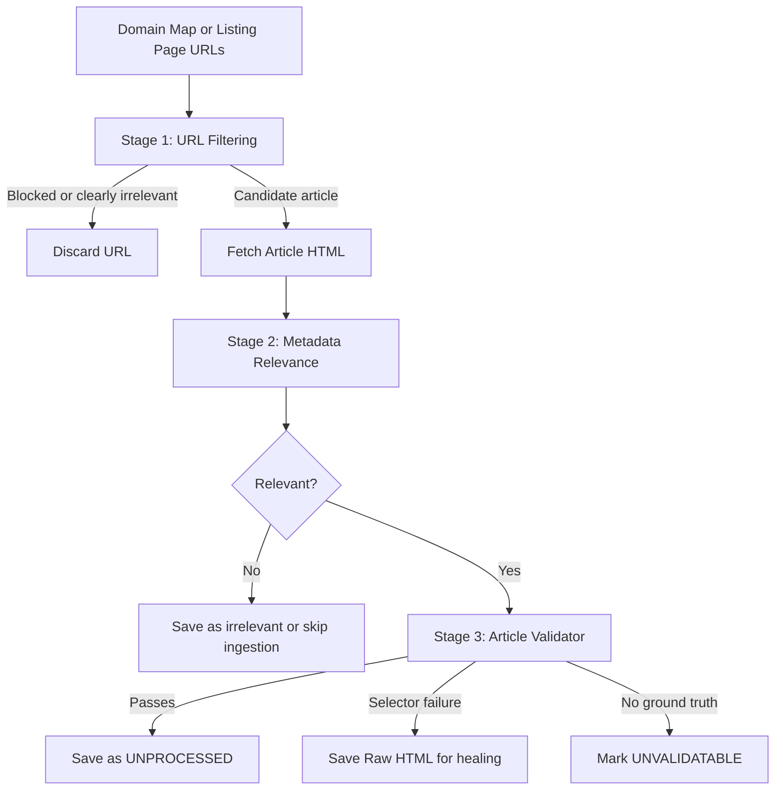
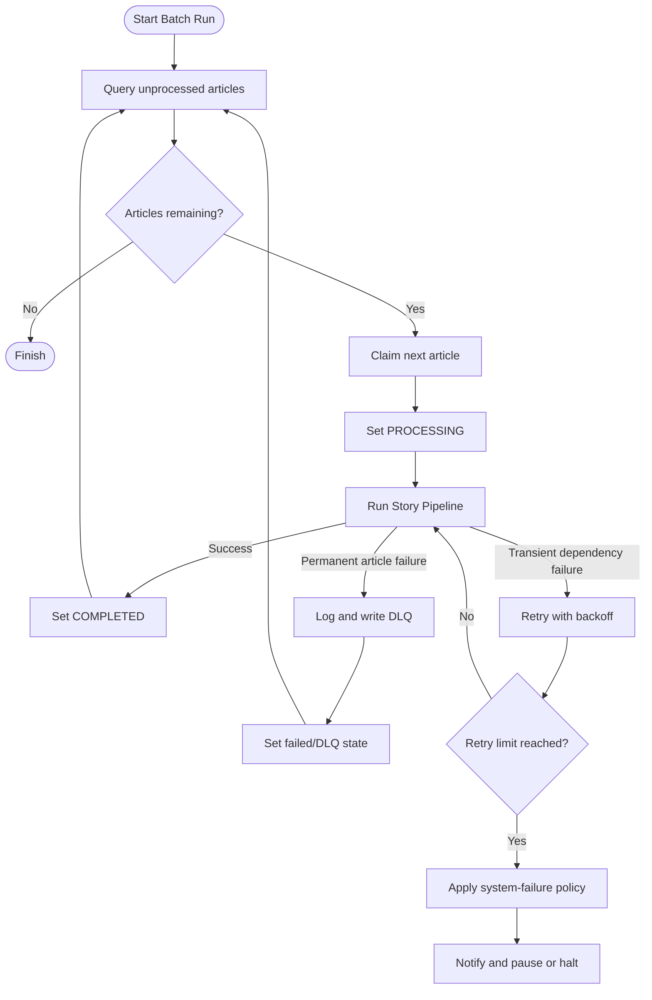

#project 
# Project Notes and Backlog

This document consolidates working notes, known risks, open design questions, and completed work for the California Political Knowledge Map. It is a planning document, not the domain glossary or an implementation specification.

Priority labels are provisional:

- **P0** — blocks correctness, data integrity, or reliable operation.
- **P1** — important for the next dependable iteration.
- **P2** — useful improvement or design exploration.

## Current priorities

1. Make model-backed workflows reliable: retries, typed LLM errors, bounded retry context, and Evaluation Gold Sets.
2. Make ingestion and scraping failure semantics explicit: distinguish article failures from system failures and define when a batch may continue.
3. Improve extraction correctness: multi-label ingestion, chunk-complete writes, structural identity handling, and a stronger ontology/prompt.
4. Make relevance classification measurable before optimizing the classifier or cache.
5. Capture links from the retained article content while preserving the existing cleaning boundary.

## Code audit — July 9, 2026

The backlog was checked against the current `src/`, `tests/`, ADRs, and `.scratch/` issue artifacts. Statuses below describe the implementation as it exists now; they do not imply that the design is necessarily finished.

### Confirmed defects

- **Confirmed — multi-label graph ingestion.** `Node.label` is still a single string, and both `ingest_extraction_result` and `Neo4jAdapter.ingest_chunk_extraction` interpolate only one label into Cypher. The multi-label issue is real and should remain P0.
- **Confirmed — evaluation execution is still missing.** A concurrent working-tree change has added `src/knowledge_map/evaluation/` contracts/store code and `tests/test_evaluation_contract.py`, so the earlier “no evaluation code” statement is stale. I still found no `tests/evals/` datasets, `pydantic-evals` suite/runner, or model-quality Evaluation Run, so the original backlog item remains open but should now be narrowed to execution and gold-set coverage.
- **Confirmed — the classifier-label CLI bypasses its embedding mock.** The full suite currently reports **271 passed, 1 failed**: `tests/test_main.py::test_cli_classifier_label_default`. The command reaches the live Ollama embedding endpoint instead of the patched `PydanticAIEmbeddingAdapter.process_chunks` method. This is both a test-isolation defect and an indication that the CLI owns too much embedding construction/calling logic.
- **Confirmed — prompt metadata is incomplete.** Coreference metadata contains hard-coded model, temperature, prompt version, and system prompt fields, but Selector Healing does not record equivalent prompt/model metadata in `selector_proposals`; the table stores only `critic_iterations`.
- **Confirmed — no shared LLM error base class.** `ExtractionError` and `CoreferenceResolutionError` are separate classes. `core.exceptions` classifies them together, but neither extends a common LLM-specific base error.
- **Confirmed — chunk extraction is not part of the extraction protocol.** The protocol exposes `extract`, while chunk iteration is implemented directly in `StoryPipeline`; there is no `extract_from_chunks` method.
- **Confirmed — system failures are represented as article status.** `ArticleStatus.SYSTEM_ERROR` exists and is written by both `StoryPipeline` and `BatchIngestionService`, even though the notes correctly question whether infrastructure failure belongs on the Source Article.
- **Confirmed — `is_url_known` checks both `stories` and `scraped_html_cache`.** The classifier concern is accurate if the intended ownership is only the Raw HTML Store; the current behavior is deliberate in code but not cleanly separated by state.
- **Confirmed — the embedding adapter uses a one-worker executor.** `PydanticAIEmbeddingAdapter._run_async` creates `ThreadPoolExecutor(max_workers=1)` when called from a running event loop. This is a synchronous bridge, not parallel embedding, and should be documented or redesigned.

### Resolved or stale notes

- **Resolved — missing `content` and fake URL concerns.** `SourceArticle.content` is required by the Pydantic schema, and no current `process_story` function or fake-URL fallback was found. Those notes describe an earlier implementation and should not remain as current defects.
- **Resolved — vector-index question.** `Neo4jAdapter.connect()` calls `_ensure_vector_index()` once per adapter lifecycle and tests patch that behavior. The open question can be removed unless startup cost or migration semantics become a concern.
- **Resolved — metadata fallback.** `extract_metadata()` falls back from JSON-LD to Open Graph, Twitter, and title/meta tags. The remaining question is how to reconcile conflicting values, not whether a fallback exists.
- **Resolved — async validation.** `ArticleValidator.validate_pending_articles()` is async, the CLI uses `asyncio.run`, and tests await it. The old “CLI will have to be async” and “tests need `pytest.mark.anyio`” notes are stale; the current tests use async-compatible fixtures/markers as needed.
- **Resolved — link capture.** The implementation extracts links from retained content and `tests/test_article_validator.py::test_validate_pending_articles_extracts_and_saves_links` covers it. This feature should move from backlog to completed work.
- **Resolved — selector-healing concurrency guard.** The code checks unresolved proposals and `healing_in_progress`, sets/clears the flag, and resets stale flags during DB initialization. Keep the item only as a concurrency-hardening follow-up if atomic claiming is required.
- **Resolved — heuristic validation in healing.** The healing flow performs programmatic selector validation as well as critic validation. The old unchecked-heuristics concern is stale.
- **Resolved — circuit-breaker worker shutdown.** The validation/healing code contains the breaker exit and worker-wait behavior, with tests covering the relevant flow.
- **Resolved — raw HTML purge exists.** `purge_html_cache()` implements the retention policy and has dedicated tests. Whether the story `COMPLETED` dependency should be redesigned remains open.
- **Resolved — batch retry categories exist.** `StoryPipeline` has rate-limit/connectivity retry handling, and the batch layer distinguishes DLQ-bound failures from system errors. This does not yet prove that every LLM transport failure is classified correctly.

### Partially implemented

- **Partial — LLM retries.** Pydantic AI agents have bounded validation retries, Coreference Resolution has annotator/critic retries, and `StoryPipeline` retries classified rate-limit/connectivity errors. There is no single retry policy for all model calls, no common LLM error hierarchy, and no clear test matrix for transport, timeout, malformed output, and rate-limit failures.
- **Partial — structural identity fallback.** Structural mismatch causes bounded retries and, when `raise_on_failure=False`, returns the original text. The production adapter uses `raise_on_failure=True`, so a mismatch is DLQ-bound rather than silently processed; however, the retry history grows through `message_history` and the “leading section omitted” case remains unnormalized.
- **Partial — graph-input validation.** Pydantic validates node labels and relationship types against injection characters, and read-side labels are regex-validated. Dynamic Cypher still relies on model validation and does not use a shared identifier type/allowlist for every interpolated label/type path.
- **Partial — relevance classifier.** Human-labeled examples are bounded to three per class in `get_gold_standard_examples`, but there is no evaluation proving that static examples help, no explicit dataset-management workflow, and the current CLI test failure shows the classifier path is not fully isolated.
- **Partial — failure handling.** Article-scoped extraction/coreference failures go to the DLQ and continue; system failures are retried only for recognized API categories and the batch aborts after consecutive failures. Adapter contracts and the exact state machine are still implicit rather than represented as a single typed result/transition model.
- **Partial — CalMatters cleanup.** HTML pruning, normalization, metadata fallback, and retained-content link extraction exist. The claim that CalMatters still produces duplicated/irrelevant content requires fixture-level or live-HTML evidence before being treated as a confirmed defect.

### Not confirmed by static inspection

- Whether the current CalMatters selectors still produce unacceptable output in production.
- Whether dissenting metadata tags occur often enough to justify a precedence policy.
- Whether author rows need to be normalized into individual records.
- Whether `get_node_rank` is materially over-complex for its actual query workload.
- Whether embeddings are being generated for the entire article body in the relevance path; the current classifier code and tests should be traced with runtime instrumentation before changing it.
- Whether Logfire’s current optional-import behavior is an intentional supported mode or an unfinished migration.
- Whether the remaining logging is materially duplicated in production; source inspection confirms multiple logging layers, but not their runtime frequency.

### Verification command

```text
uv run pytest -q
271 passed, 1 failed
```

The failure is currently the classifier-label CLI test described above. No production code was changed during this audit; only this documentation was updated.

## Known issues and risks

### Extraction and graph persistence

- **P0 — Multiple labels are lost.** `ingest_extraction_result` does not apply all labels when an extracted node has more than one label.
- **P0 — Partial chunk writes can produce incomplete data.** Extraction should run per Article Chunk, but persistence should occur only after all chunks have completed successfully. Extractions from earlier chunks must be retained in the final result.
- **P1 — Structural identity checks are brittle.** The assistant repeatedly omits leading text such as “In Summary,” causing structural identification to fail even when the rest of the output is sound. Define a tolerant boundary/normalization strategy without weakening identity guarantees.
- **P1 — Extraction failure handling is under-specified.** Strengthen field descriptions against hallucinated nodes, define semantically equivalent acceptable errors, and add a fallback to a more capable model when appropriate.
- **P1 — Retry context grows too large.** Repeated annotator retries currently expand context and may degrade results. Retries need bounded context, explicit attempt state, and a compact failure summary.
- **P1 — Entity Extraction needs a typed error hierarchy.** Introduce an LLM failure base class with specific extraction and Coreference Resolution errors.
- **P1 — The ontology and extraction prompt need another revision.** Version the execution and critic prompts and refine the ontology before expanding evaluation coverage.
- **P2 — Add `extract_from_chunks` to the Entity Extraction protocol and module.**

### LLM reliability and evaluation

- **P0 — LLM calls need retry handling.** Define retryable versus permanent failures, exponential backoff, rate-limit behavior, maximum attempts, and observability fields.
- **P0 — Mocked data cannot validate model-backed workflows.** Evaluations must use an Evaluation Gold Set and record Evaluation Runs against real or explicitly pinned model configurations.
- **P1 — Create evaluations for every agentic workflow.** At minimum cover Coreference Resolution, Entity Extraction, Selector Healing, relevance classification, and fallback behavior.
- **P1 — Record complete agent metadata.** `get_agent_metadata` should include model, temperature, prompt version, and execution/critic prompt versions.
- **P1 — Define the boundary between tests and evaluations.** Tests should verify deterministic behavioral contracts and failure handling; evaluations should measure model quality against an Evaluation Gold Set. Tests should not merely mirror implementation changes.

### Scraping and Article Validator

- **P0 — CalMatters output is noisy.** Clean duplicated and irrelevant content before it reaches the LLM, while retaining links embedded in the content that survives cleaning.
- **P1 — Metadata fallback is incomplete.** Use meta tags as a fallback when JSON-LD ground truth is absent or incomplete, and define how dissenting metadata values are reconciled.
- **P1 — Define `validate_article`'s return shape.** The result should clearly distinguish valid, invalid, and unvalidatable outcomes and include the evidence used.
- **P1 — Clarify `UNVALIDATABLE`.** It means there is no reliable ground truth against which selectors can be checked; it is not equivalent to a failed Article Validator result.
- **P1 — Define selector recovery for the last failed articles.** Establish a repeatable workflow for inspecting, proposing, approving, and applying Selector Versions.
- **P1 — Decide whether selector healing is already in progress before spawning work.** Prevent concurrent healing jobs for the same Publication.
- **P1 — Define selector rejection granularity.** Decide whether one bad field rejects a complete Article Selector set or only the affected field.
- **P2 — Clarify the guided-healing flow.** Document how it differs from the intended Generator/Critic workflow and whether `run_selector_healing_flow` should own avoidance decisions.
- **P2 — Revisit negative selectors.** A selector currently classified as negative may still be useful for a particular field or layout variant.
- **P2 — Simplify model selection helpers.** Consider one typed model factory or protocol instead of multiple `_get_model` functions.
- **P2 — Reassess `get_node_rank`.** It appears more complex than the ranking behavior requires.
- **P2 — Split authors into individual rows only if querying them independently is valuable.** Record the query/use case before changing the storage model.
- **P2 — Decide whether the story `COMPLETED` field and purge-cache command remain necessary** after the Raw HTML Store becomes robust.

### Ingestion and batch orchestration

- **P0 — Define continuation rules.** The ingestion pipeline must decide whether an adapter failure is article-scoped and allows the next article, or system-scoped and requires pausing/stopping.
- **P0 — Separate article failures from system failures.** A Source Article should not be blamed for infrastructure failures. Reconsider representing system errors as an article status.
- **P1 — Define adapter failure contracts.** Adapters should return a typed success/failure result or raise typed exceptions consistently; do not mix payloads with ambiguous success flags.
- **P1 — Add DLQ logging for non-breaking pipeline events.** Every permanent or intentionally skipped failure should be observable even when the batch continues.
- **P1 — Use context managers consistently.** Replace remaining `try...finally` connection handling with `Neo4jAdapter` context managers.
- **P1 — Decide whether `Neo4jAdapter.connect` should call `_ensure_vector_index`.** Make index readiness an explicit connection invariant or a separately managed startup concern.
- **P1 — Janitor should trigger the pipeline only after a successful health check.**
- **P2 — Resolve duplicate logging and localize log events.** Logging opportunities should live near the event that produces them; avoid emitting the same event from both adapter and orchestration layers.
- **P2 — Abstract the console notifier behind an adapter.** Only call `logger.critical` when output is not being streamed to a live terminal.

### Relevance classification

- **P0 — Establish a trustworthy labeled dataset.** Wipe/relabel `RELEVANT` articles as needed, define human-label provenance, and preserve the distinction between automated `Relevance Status` and human ground truth.
- **P1 — Validate the classifier pipeline end to end.** Confirm that `is_url_known` checks the right records, that early relevance checking happens after the training dataset is ready, and that embedding generation is actually part of the relevance path.
- **P1 — Remove unnecessary concurrency.** Explain or remove `ThreadPoolExecutor(max_workers=1)` if no parallelism is intended.
- **P1 — Define fallback examples.** Document where static examples come from, test whether they improve classification, and measure them in an evaluation.
- **P1 — Bound gold examples.** `get_gold_standard_examples` likely returns too many examples; define selection and maximum-count rules.
- **P1 — Clarify training-update semantics.** A model update that uses only human `relevance_label_source` records must have an explicit query and test.
- **P1 — Reduce overloaded cache statuses.** Separate cache existence, relevance decision, validation state, and processing state rather than encoding multiple meanings in “irrelevant.”
- **P1 — Add rationales to relevance objects** if they are needed for review, debugging, or evaluation.
- **P2 — Compare heuristics with logistic regression** only after the gold dataset and evaluation protocol are stable.
- **P2 — Make `validate_pending_articles` async-aware.** The CLI and tests should use the project’s AnyIO conventions.
- **P2 — Verify `--review-all` behavior.** Determine whether most Raw HTML Store records already have embeddings and avoid recomputing them unnecessarily.

### Selector Healing and scraping operations

- **P1 — Record prompt versions in `selector_proposals`.** Store Generator and Critic versions so self-healing efficiency can be measured.
- **P1 — Define the baseline word-count ratio.** Document the acceptable ratio between metadata/baseline word count and scraped content length.
- **P1 — Capture article links.** Extract links from the retained content elements, after ads, scripts, and irrelevant markup have been removed.
- **P2 — Clarify the long-horizon scraping state model.** The completed work should have one explicit definition of where an Archive Crawler is in the process and how it resumes.
- **P2 — Revisit `discovery_config_json`.** Promote frequently queried configuration values to first-class fields if they are not truly opaque configuration.
- **P2 — Decide on Logfire deliberately.** Document whether it is a supported observability dependency and apply that decision consistently.
- **P2 — Understand the threading model.** Document why `threading.Thread` is used, where work is joined, and which operations are safe to run concurrently.

## Design principles and unresolved decisions

### Extraction integrity

An Article Chunk is an intermediate unit of work, not an independently publishable annotation. The Story Pipeline may accumulate successful chunk results, but the graph write must require a complete, validated set of chunks. A failed or un-coreferenced chunk must prevent persistence of the incomplete Source Article.

### Failure taxonomy

Use three operational categories:

1. **Article-scoped permanent failure** — send to the DLQ, record the reason, and continue the batch.
2. **Transient dependency failure** — retry with bounded exponential backoff; if exhausted, apply the batch’s system-failure policy.
3. **System-scoped failure** — stop or pause the batch, notify an operator, and do not mark the article as if it were defective.

The exact status vocabulary and transition rules still need to be recorded in an ADR once the behavior is agreed.

### Extraction philosophy and traffic direction

The project should respect publishers while building a public-interest knowledge map. At minimum:

- honor robots.txt and each Publication’s Politeness Policy;
- link back to the original Source Article and Publication in user-facing outputs;
- retain attribution and publication metadata in the graph;
- avoid republishing more article text than is necessary for the product’s purpose; and
- make the knowledge map a discovery layer that directs readers to the original reporting.

### Proposed scraping flow



### Proposed batch flow



## Completed work

### Architecture and schemas

- Validators moved into a separate schema module.
- `IDENTIFIER_REGEX` replaced with Pydantic schema validation.
- Playground refactored into modules; prompts moved into organized text files; modules moved under `src`; Neo4j manager separated; actions moved into workflow/action modules.
- `Neo4jAdapter` now supports `__enter__` and `__exit__`, including exception handling in `__exit__`.
- Structural Identity Check added for annotations.
- Dead Letter Queue added for failed annotations in the Coreference Resolution pipeline.
- Coreference pipeline exception moved into the adapter.
- DLQ logging removed from batch ingest.

### Scraping and validation

- HTML is pruned before it is sent to the LLM.
- Word count is used when available, with fallback strategies.
- Long-horizon document scraping now tracks progress through the complete scraping process.
- Raw HTML can be removed from the database without deleting the surrounding record.
- Selector proposal critic iterations were clarified as retries.
- Selector proposals are no longer queried on every validation iteration.
- Heuristic validation is included in the selector-healing flow.
- Validation-loop exit on Circuit Breaker trip waits for worker threads to finish.
- Meta `author` fallback was added.
- Text cleaning and normalization were moved earlier in validation.
- `validate_extraction` and `validate_field` were consolidated where behavior was duplicated.
- Repeated `init_db` calls were reduced.
- `pytest.mark.anyio` usage was investigated/documented.
- Double logging was identified as a problem to resolve.

### Batch operations and observability

- SQLite-backed batch state tracking and orchestration were implemented.
- Transient and permanent pipeline failures were categorized, with exponential backoff and localized rate-limit locking.
- Pydantic Logfire integration was added and production trace-export issues were resolved.
- A `ca-map janitor` diagnostics command and adapter health checks were added.
- URL matching and CalMatters extraction targets were corrected.
- Imports were standardized and core domain language was documented in `CONTEXT.md`.

## Project observations

### Model-assistant failure modes

- The assistant tends to optimize the immediate local change and miss contradictions elsewhere in a larger design.
- It is literal and may implement an internally inconsistent choice without challenging the premise.
- It can produce polished but weak ideas when requirements are underspecified.

Countermeasures: require a consistency pass after each substantial change; test the proposed behavior against neighboring workflows; explicitly state invariants and failure semantics; and use an evaluation or review checklist rather than relying on prose quality.

### Recent notes

- **June 29:** QA exposed an issue where the pipeline was not embedding correctly.
- **June 30:** Structural identification repeatedly failed when the assistant omitted leading section text. Chunk-complete writes and bounded retry context were identified as necessary follow-ups.

## Operational note

For local recovery of a Publication’s validation state:

```sql
UPDATE publications
SET healing_in_progress = 0,
    failure_points = 0,
    validation_paused = 0
WHERE id = 'calmatters';
```

Use this only as an operator recovery action after confirming that no healing process is still running.


## Loose Notes
should I have versions for all comparison operations? are they sophisticated enough? custom comparisons
~~We cannot apply evaluators to individual cases right now.~~


### Spec

**Task failures are labeled “safe” without a safety boundary.** At target lines 310–319, every runtime exception becomes `category="task_execution"`, `retryable=False`, and `failure_evidence={"error_stacktrace": ...}`. [`_safe_error_message` (line 637)](/Users/akaisenghor/Projects/california-political-knowledge-map/src/knowledge_map/evaluation/runner.py:637) only removes text before the first `": "`; it does not redact credentials, provider payloads, prompts, or personally sensitive exception data. The full stack trace is then serialized into the relational `task_outcome_json`.

Consequences:

- Provider-specific or sensitive material can enter the ledger despite the safe/provider-neutral contract.
- Retryability and failure category are structurally present but cannot reflect provider- or component-aware classification.
- This conflicts with the PRD’s direction to keep large or sensitive raw failure evidence outside relational tables by default.

A normalizer seam should produce the `TaskFailure` from an exception, with a conservative redacted default and large/raw evidence represented separately as an artifact.

### issue
Typed success/failure outcome with normalized failure details and no provider SDK objects`TaskFailure.failure_evidence`; `run` converts `pydantic-evals` failures to strings and typed fields[Typed failure contract (line 134)](/Users/akaisenghor/Projects/california-political-knowledge-map/tests/test_evaluation_runs.py:134), [runner task failure (line 212)](/Users/akaisenghor/Projects/california-political-knowledge-map/tests/test_evaluation_runs.py:212)**Partially satisfied** — the shape is complete, but runtime normalization hardcodes category/retryability and does not actually sanitize messages or stack traces.


@01

bindings and catalog? Is that necessary? Why can't bindings stand in for the catalog of requirements


Allow for an eval report to complete if all the case evaluations have finished feels like a mistake

remove shims around allowing tests and non existent database entries to keep working

###### validation w duplicate business logic
We check validation so often which is generally good, but I often feel like we are repeating validation. An example is in `_collect_case_issues` in the preflight file where we check that case requirements are in suite catalog and suite bindings but this is done again by resolve_case_evaluators and in the `has_unique_suite_local_references` function.

EvaluationSuite.validate_cases and `preflight._collect_case_issues` enforce the same invariant but they do that in different ways. This causes potential drift 

There are, however, four real duplication problems:

- `_collect_case_issues` and `validate_cases` express the same case/Suite compatibility rules in different implementations. Their error behavior differs—preflight accumulates every issue while `validate_cases` fails immediately—but the predicates can drift.
- `EvaluationSuite.execute()` validates all cases at line 623, then calls `resolve_case_evaluators()` for every case, which validates each case again at line 549.
- The durable runner completes preflight and then validates the same selected cases again at [runner.py (line 265)](/Users/akaisenghor/Projects/california-political-knowledge-map/src/knowledge_map/evaluation/runner.py:265). Because these Pydantic models are frozen and nothing mutates them between those calls, this adds little defense.
- Evaluator resolution itself exists twice: [`_resolve_effective_evaluators` (line 257)](/Users/akaisenghor/Projects/california-political-knowledge-map/src/knowledge_map/evaluation/preflight.py:257) creates the plan with provenance, while `resolve_case_evaluators` separately derives essentially the same assignment without provenance.


###### why the fucky are we not drawing from the preflight during a run??
check the EvaluationRun for all sorts of duplications

###### validate run creation validates on information that should be derived from plan
it validates that run info = plan info but why aren't we establishing a run off of a plan? That seems silly.

###### pretty sure I will want to make it so that if plan is none we fail in EvaluationSuite.execute

###### `_NoneSafeReportEvaluator` drop failures silently

###### remove release gates or reject in runner.py
One genuine API hazard should also be addressed: `run()` still accepts `release_gates` at [runner.py (line 483)](/Users/akaisenghor/Projects/california-political-knowledge-map/src/knowledge_map/evaluation/runner.py:483), but silently ignores it; gates now execute only in `finalize()` ([runner.py (line 874)](/Users/akaisenghor/Projects/california-political-knowledge-map/src/knowledge_map/evaluation/runner.py:874)). I recommend rejecting `release_gates` in `run()` or removing/deprecating that parameter so callers cannot silently lose gate evaluation.

###### terminal recovery in `assert_run_is_complete` is super slow

###### there are a lot of repetitive checks to ensure that we aren't running an evaluation report with cases undone or from outside the evaluation runner

###### I am not sure `read_artifact` is very robust

###### duplicate code in @runner.py
`_RecordingEvaluator` and `RecordingReportEvaluator` have nearly identical evaluate and evaluate_async calls.

- **Judgement call — Duplicated Code.** [store.py (line 826)](/Users/akaisenghor/Projects/california-political-knowledge-map/src/knowledge_map/evaluation/store.py:826) constructs the canonical checkpoint document, but the same integrity-sensitive shape is reconstructed independently at [store.py (line 1385)](/Users/akaisenghor/Projects/california-political-knowledge-map/src/knowledge_map/evaluation/store.py:1385). Extract one typed document/hash function for writing and verification.
    
- **Judgement call — Divergent Change.** `SQLiteEvaluationLedger` now owns both persistence and schema-driven framework projection through [materialize_report_case (line 926)](/Users/akaisenghor/Projects/california-political-knowledge-map/src/knowledge_map/evaluation/store.py:926) and [materialize_aggregate_report (line 1446)](/Users/akaisenghor/Projects/california-political-knowledge-map/src/knowledge_map/evaluation/store.py:1446). Move evidence interpretation into a materializer service.


~~- **[P1] Frozen reports lose typed values.** [reporting.py (line 20)](/Users/akaisenghor/Projects/california-political-knowledge-map/src/knowledge_map/evaluation/reporting.py:20) converts Pydantic values to JSON and reconstructs them as dictionaries at line 63. A report evaluator using `case.output.answer` works in-memory but fails during durable finalization. This violates ticket 08’s requirement to freeze the “exact aggregate Pydantic Evaluation Report.”~~
    
-~~ **[P1] Finalization leases can expire during evaluator execution.** [runner.py (line 857)](/Users/akaisenghor/Projects/california-political-knowledge-map/src/knowledge_map/evaluation/runner.py:857) checks ownership before a potentially long call but never renews the lease. A second worker can acquire it and concurrently invoke the same evaluator, violating [ticket 09 (line 15)](/Users/akaisenghor/Projects/california-political-knowledge-map/.scratch/case-evaluation-requirements/issues/09-guard-evaluation-finalization-against-competing-workers.md:15).~~
    
- **[P1] Evaluator artifacts lack an atomic checkpoint path.** [runner.py (line 317)](/Users/akaisenghor/Projects/california-political-knowledge-map/src/knowledge_map/evaluation/runner.py:317) translates only executions and observations, while [store.py (line 802)](/Users/akaisenghor/Projects/california-political-knowledge-map/src/knowledge_map/evaluation/store.py:802) accepts no evaluator artifact links. Separate linking calls are non-atomic, contrary to tickets 05 and 08.
    
- **[P1] A report-freeze failure strands a completed case phase.** [runner.py (line 709)](/Users/akaisenghor/Projects/california-political-knowledge-map/src/knowledge_map/evaluation/runner.py:709) marks the run failed; finalization then refuses it because no artifact or `FINALIZATION_PENDING` state exists. A retry reruns the population instead of recovering the same run, defeating the PRD’s same-run report recovery.
    
- **[P2] Case issues are not checkpointed with the case.** [runner.py (line 364)](/Users/akaisenghor/Projects/california-political-knowledge-map/src/knowledge_map/evaluation/runner.py:364) retains missing-metric issues only in memory. A process interruption after the case commit loses those diagnostics, violating [ticket 05 (line 17)](/Users/akaisenghor/Projects/california-political-knowledge-map/.scratch/case-evaluation-requirements/issues/05-checkpoint-one-durable-case-through-the-shared-engine.md:17).
    
- **[P2] The component-owned catalog is Suite revision content.** [suites.py (line 369)](/Users/akaisenghor/Projects/california-political-knowledge-map/src/knowledge_map/evaluation/suites.py:369) embeds the complete catalog and includes it in the Suite hash. Adding an unrelated component catalog key therefore revises every Suite, conflicting with the [PRD ownership and revision split (line 84)](/Users/akaisenghor/Projects/california-political-knowledge-map/.scratch/case-evaluation-requirements/PRD.md:84).


**[P1] Forbidden structured values are normalized before validation.** [runner.py (line 1105)](/Users/akaisenghor/Projects/california-political-knowledge-map/src/knowledge_map/evaluation/runner.py:1105) calls `model_dump(mode="json")` before constructing `StructuredMetricValue`. Pydantic converts non-string mapping keys to strings and tuples to arrays, so strict validation never sees—and therefore cannot reject—the forbidden originals.

I reproduced this directly: `{1: "x"}` became `{"1": "x"}` and `(1, 2)` became `[1, 2]`, after which `StructuredMetricValue` accepted the payload. This conflicts with the ticket requirement that non-string keys and arbitrary runtime containers be rejected.

Validate the Python-mode dump before JSON normalization and add runner-path regression tests.


`ResolvedSchemaBinding` can be constructed directly with any fingerprint-compatible Pydantic model, bypassing `SchemaRegistry`. Materialization then trusts that model, violating the requirement that concrete models be resolved only through an explicit allowlist.

Spec: “concrete models resolved only through an explicit allowlisted registry.”


------


- **High — documented-standard breach:** [runner.py (line 1161)](/Users/akaisenghor/Projects/california-political-knowledge-map/src/knowledge_map/evaluation/runner.py:1161) polls controlled stopping only inside the evaluator loop. A stop requested during the last evaluator—or with no evaluators—still permits Release Gates to begin at line 1248. This violates [CONTEXT.md (line 243)](/Users/akaisenghor/Projects/california-political-knowledge-map/CONTEXT.md:243), which requires no further evaluator or gate work after an in-flight evaluator returns.
    
- **Low — judgement call, Duplicated Code:** [store.py (line 1145)](/Users/akaisenghor/Projects/california-political-knowledge-map/src/knowledge_map/evaluation/store.py:1145) duplicates the replay-consistency algorithm for executions and observations: look up by ID, reconstruct and compare, then check natural identity. A ledger-internal helper could prevent their replay semantics drifting apart.
    

No other documented-standard breaches found.

## Spec

- **P1 — controlled stop ignored after final evaluator:** [runner.py (line 1161)](/Users/akaisenghor/Projects/california-political-knowledge-map/src/knowledge_map/evaluation/runner.py:1161) checks `should_stop_finalization` only before evaluator iterations. After the final evaluator returns and checkpoints, execution proceeds directly to gates and completion. This contradicts [tickets.md (line 115)](/Users/akaisenghor/Projects/california-political-knowledge-map/.scratch/renewable-evaluation-finalization-authority/tickets.md:115): “A controlled stop waits for an already-running evaluator to return and then starts no later evaluator or Release Gate.” The existing regression uses two evaluators, so the next iteration masks this edge case.
    
- **P2 — renewal contention can outlive confirmed authority:** [runner.py (line 434)](/Users/akaisenghor/Projects/california-political-knowledge-map/src/knowledge_map/evaluation/runner.py:434) treats a retryable failure from `owns_finalization_claim()` as sufficient to continue. The retry loop at line 487 never compares time against `_last_confirmed_expiry`; if both renewal and ownership reads remain contended, it can retry indefinitely beyond the lease. This contradicts [tickets.md (line 67)](/Users/akaisenghor/Projects/california-political-knowledge-map/.scratch/renewable-evaluation-finalization-authority/tickets.md:67) and [PRD.md (line 99)](/Users/akaisenghor/Projects/california-political-knowledge-map/.scratch/renewable-evaluation-finalization-authority/PRD.md:99), which require retries to remain bounded by the last confirmed live lease.


I am going to have to move materialize from `store.py`

