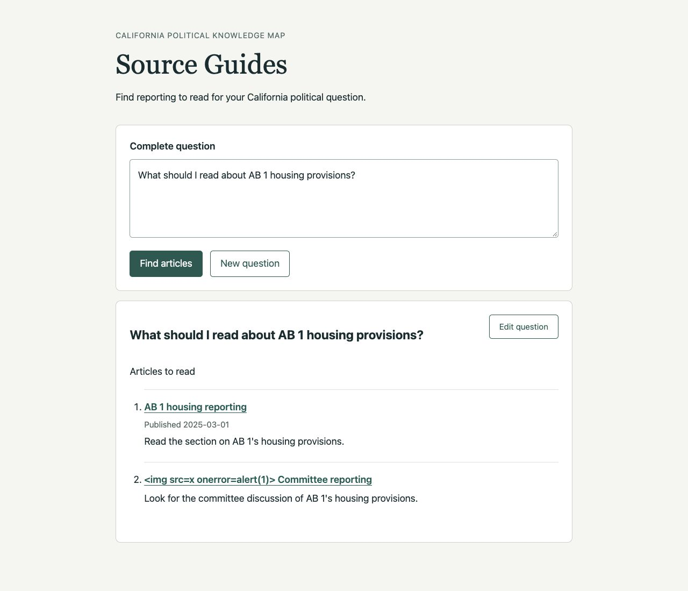

# Ticket 01 implementation evidence

Implementation base: `d512b7153f0fac441be5e34a84800ef1148aa8b5`.
Verification date: 2026-10-09 UTC. Ticket acceptance checkboxes are left for the
independent reviewer.

## Chosen seams

The primary seam is the existing FastAPI HTTP/ASGI application. Tests submit
complete questions to `POST /api/questions`, using the real Chat Agent,
Chat Session, Retrieval Coordinator, fusion, and Evidence Assembler with
controlled external model, graph, embedding, and document-store IO. No new
independent Chat Session test seam was introduced. The shared consumer seam is
the existing chat evaluation task. Browser verification uses the packaged page
and its controls with controlled model/retrieval dependencies.

The direct path preserves the internal QueryRewrite transport with unchanged
question text. It does not instantiate or invoke a Query Rewriter. The retained
legacy preparation workflow and historical output fields remain interpretable.
New evaluations explicitly record `direct_question`; old records retain
`approve_first_proposal`. RetrievalAnswer guidance contract 1 remains the default
when parsing historical records; new execution records contract 2.

This ticket runs within the submission request. Saving guides, detached work,
updates, grouping, and targeted article links remain in later tickets.

## Acceptance evidence

| Criterion | Evidence |
| --- | --- |
| Original wording reaches assessment and retrieval directly | `test_submission_searches_the_complete_question_without_rewriting_or_approval` checks names, dates, bounds, and order at the HTTP seam, model inputs, and all three branch requests. Startup tests verify that only the Chat Agent is created/probed for this path. |
| Broad questions proceed; unresolved references request complete edits | Parameterized HTTP assessment tests distinguish allowed, needs_edit, and Declined. Browser editing passes. Real-model cases SG01-broad and SG01-unresolved produce allowed/completed and needs_edit respectively. |
| Every displayed article passes the final relevance gate | HTTP projection tests omit candidates without source notes. Unknown references, duplicate notes, and blank notes fail validation. The final model run directs reading without giving the arguments; SG01-directions includes only the hearing article, and SG01-irrelevant rejects all candidates. |
| Complete question, all selected articles, citation links/dates and requested order | HTTP tests preserve relevance ordering and sort both publication directions with missing dates omitted and undated articles last. Browser page displays the complete question and both included fixture articles; link navigation opens separately. |
| No Article Chunk bodies; validated references and safe display | HTTP sentinel checks prove evidence passages are absent from public JSON and shared rendered text. Internal evidence remains available to audit/evaluation. Browser markup title appears literally, with zero injected image/script elements, and HTTP(S) links have `target=_blank` plus `rel=noopener noreferrer`. |
| Existing architecture and typed outcomes remain | Real coordinator/assembly tests cover Deferred, Declined, needs_edit, partial branch failures, all-branch failure, empty, assessment failure, assembly failure, and guidance failure. Existing Jev, retrieval, fusion, evidence, limits, startup ownership, audit and loopback tests pass. |
| Web and shared evaluation use one contract; history preserved | `test_chat_eval_task.py` checks direct wording and projected guide output. New prompt resources are explicitly adopted; all previous prompt files and existing evaluation reports are untouched. Prompt resource packaging/immutability tests pass. |

## Controlled semantic evaluation

Command, run through the existing `build_task`, `run_data_set`, and `write_report`
workflow:

```sh
UV_CACHE_DIR=/tmp/source-guides-uv uv run --no-sync python work/projects/source-guides/validation/run_controlled.py
```

The runner uses the actual local `gemma4:26b` Chat Agent with fixed fictional
retrieval IO. Three articles cover a housing hearing, a housing proposal, and
salmon fishing. It does not contact Neo4j, the embedding endpoint, or Jev.
The data set is `evals/unlabeled/source-guides.yaml`. Cases are development
examples, not a held-out benchmark or an accuracy score.

All reports are retained under `evals/reports/chat/`:

| Report timestamp | Instructions / policy | Observation |
| --- | --- | --- |
| 20261009T033813Z | v2 / v1 | Broad and named-bill questions incorrectly requested edits. Model-visible fixture labels also caused Declined outcomes. |
| 20261009T034132Z | v3 / v2 | Explicit broad examples alone did not fix stage confusion. The model requested evidence before retrieval and unnecessary bill years. Fixture labels were moved into provenance; realistic collection metadata was used from this run onward. |
| 20261009T034301Z | v4 / v2 | Explicit assessment/guidance stages fixed broad and named-bill search. Non-allowed assessments omitted required explanation fields and failed typed validation. |
| 20261009T034431Z | v5 / v2 | Required fields, direct reading directions, and chronology worked. The school-meal case incorrectly listed irrelevant articles with notes explaining their irrelevance. |
| 20261009T034541Z | v6 / v2 | All five intended outcomes observed. The exclusion rule explicitly rejects irrelevance explanations as reading directions. |

The final report is
[`20261009T034541Z-d512b71-local-gemma4-26b-c6ea49447276.json`](../../../../evals/reports/chat/20261009T034541Z-d512b71-local-gemma4-26b-c6ea49447276.json).

- SG01-broad is allowed and includes the two housing articles, excluding fishing.
- SG01-unresolved requests a named bill, retains the original question, and runs no retrieval.
- SG01-directions includes only the hearing article and directs the reader to its supporters/detractors sections without supplying their arguments.
- SG01-chronology retains the complete requested question, returns Deferred with a recoverable publication range, and orders the two housing articles from 2024-01-15 to 2025-03-01.
- SG01-irrelevant is a successful empty guide with a Deferred date-range explanation. None of the housing/fishing articles is included.

The model remains responsible for semantic relevance and explanation quality.
Typed validation enforces selected source identity, nonempty directions, and
unique included references; it does not prove that a generated direction is
semantically sound. The final run still phrases the school-meal coverage limit
in terms of discussions occurring after the collection boundary. That prose is
not evidence of actual reporting completeness. No production-corpus retrieval
quality claim or independent human review is made here.

## Browser verification

Used the Codex in-app browser against a loopback server at
`http://127.0.0.1:8931`, built from the real application with deterministic model
and retrieval dependencies. The local publisher fixture allowed navigation to
be checked without contacting a third-party article site.

1. Submit `Who supported that bill?`. The page displays the entire question and a request to name the bill.
2. Select Edit question. Replace the input with `What should I read about AB 1 housing provisions?`, then submit. The page displays the complete question, reading directions, two article links, and the one available publication date.
3. Inspect the malicious fixture title ` Committee reporting`. It remains literal text, no image/script node is injected, and no chunk sentinel appears.
4. Open `AB 1 housing reporting`. A separate tab displays the controlled article page while the guide remains open. Both links include the safe new-tab attributes.
5. Select New question. The input is empty and the prior guide is hidden.



These checks verify reader controls and rendering. They do not test production
model latency, actual publisher websites, persistence, or detached execution.

## Deterministic checks

All Python/Node commands used `uv`. Final checks:

- `uv run --no-sync pytest -q tests`: **1493 passed, 61 skipped, 1 warning**, 43.66 seconds. The warning is the existing OpenRouter reasoning/temperature warning. This run occurred after the final prompt adoption.
- `uv run --no-sync node --test tests/chat_eval_review_editing.test.mjs tests/rag_eval_review.test.mjs tests/chunk_eval_review.test.mjs`: **29 passed**.
- `uv tool run --offline --from ty ty check` for the eight changed application modules: **passed**. Used the temporary tool/cache paths below, without changing project dependencies.
- `uv run --no-sync ruff check` for changed application/test modules and the controlled runner: **passed**.
- `git diff --check`: **passed**.

Focused application, shared evaluation, audit, startup, Jev, legacy preparation,
and prompt tests were run during implementation. The last targeted
prompt/provenance check passed 25 tests before the full suite. Vertical slices
introduced direct submission, assessment outcomes, source projection, typed
failures, and shared-consumer migration incrementally.

The first full pytest invocation inside the restricted sandbox produced 1476
passes and 61 skips; 9 failures and 8 fixture errors were loopback bind
`PermissionError`s in existing HTTP review-server tests. The final full run was
approved with loopback binding and passed. The first browser server likewise
needed loopback permission. Type tooling used
`UV_CACHE_DIR=/tmp/source-guides-uv UV_TOOL_DIR=/tmp/source-guides-tools`; an
online metadata refresh hit restricted DNS, so the final cached type check used
`--offline` and passed.
