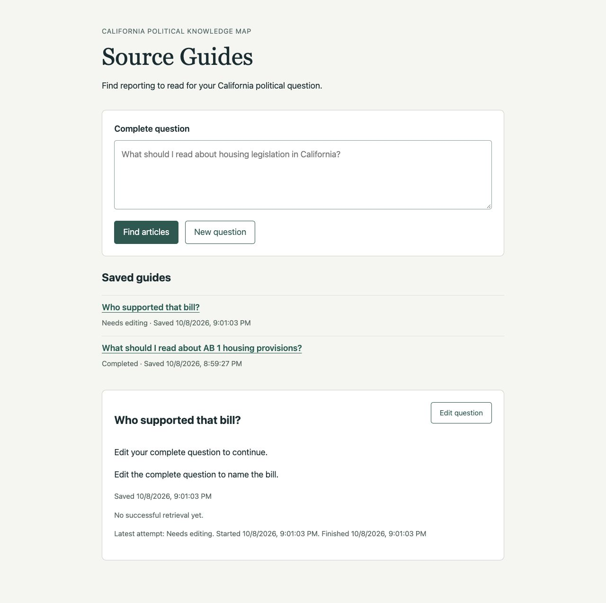

# Ticket 02 independent review and resolution

Reviewed on 2026-10-09 UTC with the repository code-review skill. Standards and
Spec reviewers ran in parallel, inherited the review owner's model, and did not
edit the implementation. The owner evaluated each finding, fixed both, and
requested independent confirmation.

- Fixed point: `945bfb29502d699fee0017875caed5f2ee4320d2`.
- Diff command: `git diff 945bfb29502d699fee0017875caed5f2ee4320d2...HEAD`.
- Reviewed implementation: `92d76f4091e8ec0363b7b77d61684f3d026c3844`,
  Persist Source Guides and reopen saved questions.
- Bounded spec: [ticket 02](../issues/02-save-and-reopen-guides.md), with the
  [parent PRD](../PRD.md). Later-ticket requirements were excluded.

## Standards

No documented-standard violations found across the changed files. Domain
vocabulary follows `GLOSSARY.md`; validation evidence follows
`docs/agents/issue-tracker.md`. No model-facing prose or prompt versions changed,
so ADR 0022 is satisfied. The ADR 0023 retrieval path remains unchanged.

One optional baseline concern, Duplicated Code, appeared in `web.py`'s failure
and success paths:

```python
saved = guide_store.finish(saved.guide_id, guide)
return JSONResponse(saved.model_dump(mode="json", exclude_none=True))
```

Both paths repeated persistence and response serialization. A shared
finalization point prevents later changes from drifting between paths. This was
a minor judgment call, not a documented-standard violation or a blocker.

Disposition: accepted and fixed. A `try`/`except`/`else` now prepares the typed
guide on either path and uses one shared persistence and response step.
Cancellation still persists interruption and propagates cancellation. The
reviewer inspected the amendment and confirmed resolution with no new concern.

Standards findings: 1 fixed, 0 invalid, 0 duplicate, 0 out of scope, 0 unresolved.
Worst original finding: minor Duplicated Code judgment call.

## Spec

P2, ignore saved-guide responses after navigation changes. `guide.js` always
rendered a completed saved-guide read, even after the reader selected New
question or another saved guide. A delayed response for A could restore A after
clearing the page or overwrite the newly selected B. This violated ticket 02's
"New question starts with empty input and carries no implicit question context
from another guide" and "Opening a guide restores its complete question."

Disposition: accepted and fixed. A selection generation invalidates earlier
reads on opening another guide, clearing the page, or submitting a new question.
Success and error responses publish only while their captured selection is still
current. The Spec reviewer confirmed three delayed-response checks against the
actual amended script using `UV_CACHE_DIR=/tmp/source-guides-uv uv run --no-sync
node` with a disposable VM and fetch substitute. New question stays empty after
delayed A; B survives A's late success; B survives A's late error without a stale
error message. No new ticket 02 concern was found.

No other missing requirement, incorrect implementation, or scope expansion was
found within ticket 02. Detached execution, updates, cancellation actions,
startup interruption scanning, Retry, and expanded coverage presentation remain
assigned to later tickets.

Spec findings: 1 fixed, 0 invalid, 0 duplicate, 0 out of scope, 0 unresolved.
Worst original finding: P2 stale saved-guide response publication.

## Browser verification

The owner reran the actual reader controls in the Codex in-app browser against
the real application and existing temporary SQLite store. A disposable runner
held one saved-guide GET using an explicit file gate, without altering the
packaged application. The browser used `http://127.0.0.1:8932`.

- Reopened the saved completed guide and inspected the retained article,
  reading direction, publication date, question, and retrieval timestamp.
- Reloaded its fragment URL with the GET held. Selected New question, then
  released that GET. The URL had no fragment, input remained empty, guide stayed
  hidden, and progress stayed empty after the old response arrived.
- Opened A with its GET held, selected saved guide B through its list link, and
  inspected B's needs-edit question and times. Released A and confirmed B stayed
  visible at B's fragment URL, with no stale progress or error.
- The model call log remained at three calls before and after all read-only
  verification. The disposable browser server was stopped afterward.



The [implementation record](ticket-02.md) supplies the original submission,
reload, service-restart, outcome-matrix, and durable-content evidence. This review
adds the navigation-race checks. Source relevance still has the limits stated in
that record; neither review claims production-corpus accuracy.

## Checks and ticket reconciliation

All Python and Node commands used `uv` with
`UV_CACHE_DIR=/tmp/source-guides-uv`. Type tooling also used
`UV_TOOL_DIR=/tmp/source-guides-tools` and cached offline execution.

- After the Standards fix, `uv run --no-sync pytest -q tests/test_chat_web.py
  tests/test_chat_web_lifecycle.py
  tests/test_chat_answer_trail.py::test_export_failure_after_startup_preserves_prepared_answer_and_search_details`:
  39 passed.
- After the Spec fix, `uv run --no-sync pytest -q tests/test_chat_web.py
  tests/test_chat_web_lifecycle.py tests/test_chat_web_corrections.py`: 39 passed.
- `uv run --no-sync node --test tests/chat_eval_review_editing.test.mjs
  tests/rag_eval_review.test.mjs tests/chunk_eval_review.test.mjs`: 29 passed.
- `uv tool run --offline --from ty ty check src/knowledge_map/web.py
  src/knowledge_map/adapters/source_guides.py
  src/knowledge_map/schemas/source_guides.py`: passed.
- `uv run --no-sync ruff check` over all Python modules and tests changed since
  the fixed point: passed.
- One final `uv run --no-sync pytest -q tests`, with approved loopback binding
  for existing local HTTP tests: 1,505 passed, 61 skipped, one existing
  OpenRouter reasoning/temperature warning, 45.33 seconds.
- `git diff --check`: passed after documentation reconciliation.

All six ticket 02 acceptance checkboxes are checked and its single triage label
is `completed`. The parent project remains `ready-for-agent`; tickets 03, 07,
08, and 09 are now takeable, as recorded in `work/README.md`. Both findings have
confirmed fixes. No valid finding or unresolved question remains.
