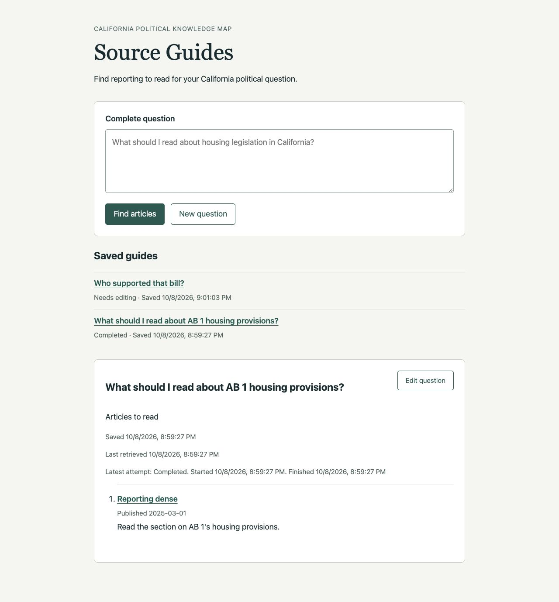

# Ticket 02 validation

Fixed point: `945bfb29502d699fee0017875caed5f2ee4320d2`.

## Test seams

The primary seam is the FastAPI application over HTTP/ASGI, with temporary real
SQLite storage and deterministic model/retrieval dependencies. Tests submit,
list, and reopen guides through HTTP, including a new application instance over
the same store. They observe saved results and timestamps, never SQL rows.
The ticket conductor authorized this seam selection under the PRD testing plan.

The browser is the additional seam for submission, saved-guide navigation,
empty New question, reload, and reopening after restart. Execution remains
request-owned in this ticket; independent execution belongs to ticket 03.

## Implemented behavior

`POST /api/questions` commits a guide identity, complete submitted question,
creation time, and running attempt before creating or running the Chat Session.
`GET /api/guides` lists saved questions and outcomes. `GET /api/guides/{guide_id}`
reads the persisted reader-safe projection without graph hydration or model calls.
These operations remain inside the existing local application protections.

`SQLiteGuideStore` uses the existing `document_store.db` default and SQLite
transactions. Guide content and its last successful retrieval timestamp are
separate from attempt identity, timing, operational status, and typed outcome.
Successful empty outcomes also receive a retrieval timestamp. Declined and
needs-edit assessments complete the attempt without claiming a successful
retrieval. Deferred remains an assessment and can accompany completed, empty,
or failed search outcomes.

The saved-guide list uses complete questions and explicit outcomes. A fragment
URL identifies the open guide, so reload restores that guide. New question
clears the fragment, input, and displayed result; independent submissions get
distinct identities and no prior question context.

## Acceptance evidence

| Criterion | Evidence |
| --- | --- |
| Save before execution, including unsuccessful questions | `test_submission_is_saved_before_execution_and_interruption_retains_the_question` pauses execution with events and reads the running guide through HTTP before releasing it. `test_failure_to_start_execution_leaves_a_saved_failed_question` proves session-construction failure also retains the question. |
| Existing SQLite, persisted content and disclosures | `test_completed_guide_reopens_after_restart_without_current_sources_or_models` creates a new app over a real temporary document store with unavailable model activity. Article reasons, title, URL, publication date, Deferred disclosure, recoverable portion, question, identity, and timestamps restore identically. The chunk sentinel stays absent. |
| Separate attempt and content information | HTTP tests assert running, completed, empty, failed, and interrupted attempt status, identity, start/finish times, typed outcome, and presence or absence of successful retrieval time. The typed model and SQLite status constraint also support cancelled outcomes for the later cancellation ticket. |
| List and detail restore saved questions and outcomes | The completed restart test and parameterized unsuccessful restart test read both list and detail, checking complete question and outcome. Browser checks cover list navigation and visible timestamps. |
| Reload/restart without another search; no expiry | Restart tests cover completed, empty, needs-edit, Declined, Deferred, assessment failure, guidance failure, retrieval failure, assembly failure, partial retrieval, and interrupted request. Controlled model/retrieval substitutes observe no calls during list/read. Browser model log stays unchanged across reload and service restart. There is no expiry operation. |
| Empty New question; local and independent | Browser input is empty after New question; existing independent-question HTTP test now also checks distinct guide identities and preservation of the first guide. Host rejection includes both new read routes. |

The existing telemetry-export-failure test now compares the reader content of
two independent submissions rather than requiring their generated identities
and times to match. It additionally proves the new guide reopens even while
telemetry export fails.

## Red-green slices

1. Completed guide restart test failed on the missing persistence configuration,
   then passed after the focused store, saved response values, and read routes.
2. Event-controlled request interruption test observed a misleading running
   outcome, then passed after interruption was persisted before cancellation
   propagated to the request owner.
3. Session-construction failure returned HTTP 500, then returned and retained a
   typed failed guide after the creation step moved inside failure handling.
4. Browser verification showed no saved-guide navigation in the original reader.
   The added list, fragment navigation, and timestamps passed the reader checks
   below. Existing fixture tests were extended to cover the remaining outcomes.

## Browser verification

The Codex in-app browser used `http://127.0.0.1:8932` with the real application,
temporary real SQLite, deterministic FunctionModel responses, and controlled
retrieval branches. The disposable runner and store are under `.scratch/`.

- Submitted `What should I read about AB 1 housing provisions?` directly and saw
  the saved article, publication date, and reading direction.
- Reloaded the reader and opened the saved question from its list.
- Selected New question and inspected the input value, which was empty.
- Submitted `Who supported that bill?` and saw the full question, needs-edit
  explanation, saved time, completed attempt times, and no successful retrieval.
- Stopped the local server and launched a new process against the same SQLite
  file. Reload restored the needs-edit guide and the saved list.
- Reopened the completed guide and reloaded its fragment URL. The original
  article, reading direction, question, and retrieval timestamp remained visible.
- The controlled model call log contained three calls before restart and still
  contained three after listing, reopening both guides, and reloading.

## Scope and limits

No detached execution, guide updates, explicit Cancel, startup recovery scan, or
Retry action is added here. Request cancellation records an interrupted outcome
when the application receives cancellation; a process killed without cleanup is
handled by ticket 06. Cancellation has a typed persistent representation, while
the reader cancellation operation and late-result protection belong to ticket 05.
This browser check uses controlled source metadata, not live publishers or a
production-corpus relevance evaluation. No prompt versions changed.

## Checks

All Python and Node commands used `uv`, with
`UV_CACHE_DIR=/tmp/source-guides-uv`. Type tooling also used
`UV_TOOL_DIR=/tmp/source-guides-tools`.

- `uv run --no-sync pytest -q tests/test_chat_web.py tests/test_chat_web_lifecycle.py tests/test_chat_web_corrections.py`: 39 passed after the final durability matrix changes.
- `uv run --no-sync pytest -q tests/test_chat_answer_trail.py::test_export_failure_after_startup_preserves_prepared_answer_and_search_details`: passed after the independent-guide expectation update.
- `uv run --no-sync pytest -q tests`: 1505 passed, 61 skipped, one existing OpenRouter reasoning/temperature warning, 45.44 seconds. Loopback binding was approved for the existing HTTP review-server tests.
- `uv run --no-sync node --test tests/chat_eval_review_editing.test.mjs tests/rag_eval_review.test.mjs tests/chunk_eval_review.test.mjs`: 29 passed.
- `uv tool run --offline --from ty ty check src/knowledge_map/web.py src/knowledge_map/adapters/source_guides.py src/knowledge_map/schemas/source_guides.py`: passed.
- `uv run --no-sync ruff check` over all changed Python modules and tests: passed.
- `git diff --check`: passed.

The first full Python run had one failure from the older telemetry test's
whole-response equality expectation, with 1504 passes and 61 skips. The final
full run above followed its correction. The browser server was stopped after
verification. No ticket 02 blocker remains; acceptance state is left to review.
