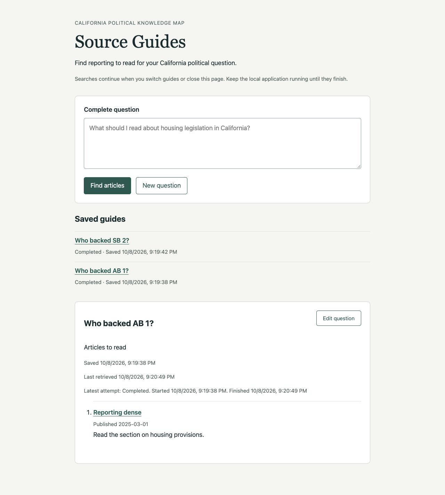

# Ticket 03 validation

Fixed point: `f66eccff180123c4d563e1af5782a16a9d0c5e2a`.

## Test seams

The primary seam is the FastAPI application over HTTP/ASGI with temporary real
SQLite. New execution tests use the real Chat Session and deterministic model
and retrieval dependencies. Explicit events hold and release model work; HTTP
reads observe saved status, content, identity, and timestamps. Scheduler
checkpoints allow in-process ASGI work to progress without timing sleeps.
No test inspects task registries or SQL rows, and no separate Chat Session test
seam was introduced.

The existing public `SQLiteGuideStore.finish` mutation is the supplementary
seam for submitting wrong and retired attempt identities. Its results are
observed through HTTP. Update and Cancel routes belong to tickets 04 and 05,
so the HTTP API cannot yet generate replacement attempts for this check.
The ticket conductor authorized and confirmed these seam choices.

The browser is the additional seam for independent submission, switching,
reload, closing and reopening the page, and automatic status refresh.

## Implemented behavior

`POST /api/questions` saves the guide and its running attempt, then returns
HTTP 202 with that identity, status, and a `Location` for persisted detail reads.
The application retains each execution until completion. Browser response
cancellation does not own or cancel the work. During application shutdown,
the lifespan stops accepting submissions and cancels and joins running work
before closing shared dependencies. Cooperative shutdown records interruption.

Completion supplies both guide and attempt identities to the store. One SQLite
transaction conditionally changes only that guide's latest running attempt,
then publishes successful content and its retrieval timestamp. A wrong identity
or already terminal attempt cannot change content, attempt status, or timestamps.
The existing distinction between typed assessment and operational status remains.

The reader refreshes its saved list and selected running guide through read-only
requests. Navigation generations prevent an older read or submission response
from replacing a newer selection or cleared New question. List request ordering
also rejects stale lists, and unchanged lists retain their existing controls.
Submission releases the form once acceptance is confirmed, allowing another
question while earlier work continues. The page explains that closing the local
application differs from closing the browser.

The existing shared model, provider admission, retrieval deadline, resource
ownership, and evidence limits remain in use. No new model-concurrency policy,
provider client, retrieval branch, or prompt version was added.

## Acceptance evidence

| Criterion | Evidence |
| --- | --- |
| Prompt saved identity and attempt status; lifespan ownership | `test_submission_returns_saved_identity_while_search_waits_for_the_model` receives 202 and reads the same running guide while the real session's model is held by an event. It then observes that same attempt's terminal result. |
| Independent progress under existing limits | `test_independent_guides_continue_after_clients_disconnect_and_reconnect` holds two questions, releases the second first, and reads completed SB 2 while AB 1 remains running. Each retrieval branch sees exactly the two submitted questions, in release order. Shared admission and deadline implementations are unchanged and their existing suite runs in CI. |
| Switching, reload, and disconnection preserve execution | The independent-guide test closes both submitting clients, reconnects with a third, and completes both searches. `test_disconnection_during_submission_response_does_not_cancel_saved_work` cancels the ASGI response before delivery, then finds the saved running question and observes completion after releasing the model. Browser checks cover navigation and reload. |
| Persisted running and terminal status without duplicate work | HTTP list and detail reads observe both states; repeated reads leave the model assessment count at one per question and branch execution count at one per question. Browser close/reopen and reload preserve the two-question model log. Existing durability and outcome tests now submit through 202 and read saved terminal results. |
| Atomic publication for the active attempt | `test_obsolete_or_wrong_guide_completion_cannot_publish_content_or_timestamps` submits another guide's attempt ID and a nonactive ID, both leaving the target unchanged. It publishes one successful empty result with matching retrieval and finish timestamps, then rejects another completion of that terminal attempt. The other guide remains running. The transaction additionally requires that the supplied attempt is the guide's latest attempt, ready for ticket 04's replacement operations. |
| Application close is distinct from browser close | `test_application_shutdown_stops_work_before_closing_shared_dependencies` observes model cancellation before dependency cleanup, an interrupted saved result, and rejection of new submissions after shutdown. Browser client closure leaves the same model work pending until released. Startup recovery and Retry remain ticket 06. |

## Red-green slices

1. The prompt-return test timed out with the old awaited route. Lifespan-owned
   execution returned 202 while the model remained held and then completed.
2. The publication test failed because completion accepted no attempt identity.
   Adding the transactional identity/status condition made the wrong-identity
   and repeated-completion assertions pass.
3. Browser verification showed SB 2 still marked Running after its controlled
   execution completed. Read-only refresh made both list and detail reflect
   completion without reload.

The remaining event-controlled tests check independent progress, cancellation
of response delivery, and application cleanup through the public application.
Existing HTTP telemetry tests were migrated to the new accepted-submission and
terminal-read contract rather than retaining an obsolete synchronous path.

## Browser verification

The Codex in-app browser used `http://127.0.0.1:8933` with the real application,
a temporary SQLite file, and the deterministic model and retrieval dependencies.
The disposable runner and database are under `.scratch/`. Async model events
were released explicitly through the disposable runner's control endpoint.

- Submitted `Who backed AB 1?`, then selected New question and submitted
  `Who backed SB 2?` while the first question remained running.
- Released SB 2 first and observed completed SB 2 alongside running AB 1.
- Opened AB 1 from the saved list and reloaded its fragment URL. Its saved
  question, identity, start time, and Running state remained visible.
- Closed the browser tab, opened another tab at the same guide URL, and saw
  the running guide and the completed sibling restored.
- Released AB 1 and waited for Articles to read to become visible. The page
  updated without navigation, and both saved rows showed Completed. The guide
  showed its original saved time, final retrieval time, article, publication
  date, and reading direction.
- The controlled assessment log was exactly `Who backed AB 1?` followed by
  `Who backed SB 2?` before and after the reload and reconnection checks.

These checks establish controlled lifecycle behavior, not live-corpus relevance
accuracy. They do not depend on changing publisher content or a production model.

## Scope and checks

Same-guide updates, the Cancel control, startup interruption scanning, and Retry
remain in their assigned tickets. The transaction already rejects publication
from a nonactive attempt; creating newer attempts through HTTP is ticket 04.
No new ADR or domain definition was needed.

All Python, Node, and type commands used `uv`, with
`UV_CACHE_DIR=/tmp/source-guides-uv`. Type tooling additionally used
`UV_TOOL_DIR=/tmp/source-guides-tools` and cached offline execution.

- Focused web, lifecycle, correction, and new execution checks: 43 passed.
- Focused retrieval, evidence, structural, and session telemetry migration checks: 54 passed.
- `uv run --no-sync pytest -q tests`: 1509 passed, 61 skipped, one existing OpenRouter reasoning/temperature warning, 46.32 seconds. Loopback access was approved for existing local HTTP tests.
- `uv run --no-sync node --test tests/chat_eval_review_editing.test.mjs tests/rag_eval_review.test.mjs tests/chunk_eval_review.test.mjs`: 29 passed.
- `uv tool run --offline --from ty ty check src/knowledge_map/web.py src/knowledge_map/adapters/source_guides.py src/knowledge_map/schemas/source_guides.py`: passed.
- `uv run --no-sync ruff check` over all changed Python modules and tests: passed.
- `git diff --check`: passed.

The first full Python run had 1505 passes, 61 skips, and four failures from one
Jev HTTP consumer still expecting a synchronous 200 response. That consumer now
uses the accepted-submission and saved-result helper, and the final full run
above passed. The disposable browser tab and server were closed after checking.
No ticket 03 blocker remains. Independent review and acceptance reconciliation
are recorded in [ticket-03-review.md](ticket-03-review.md).
