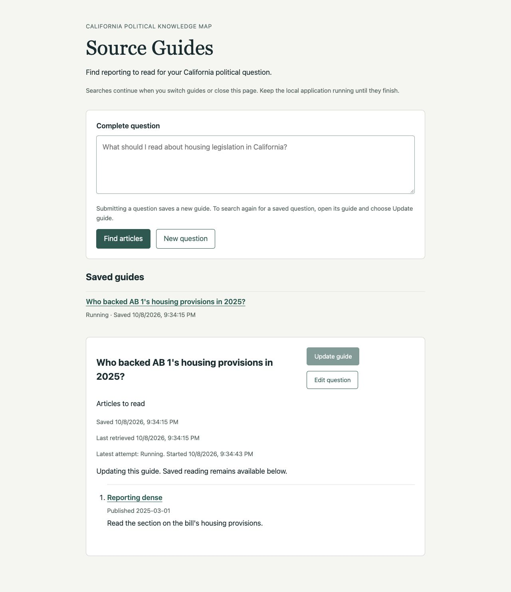
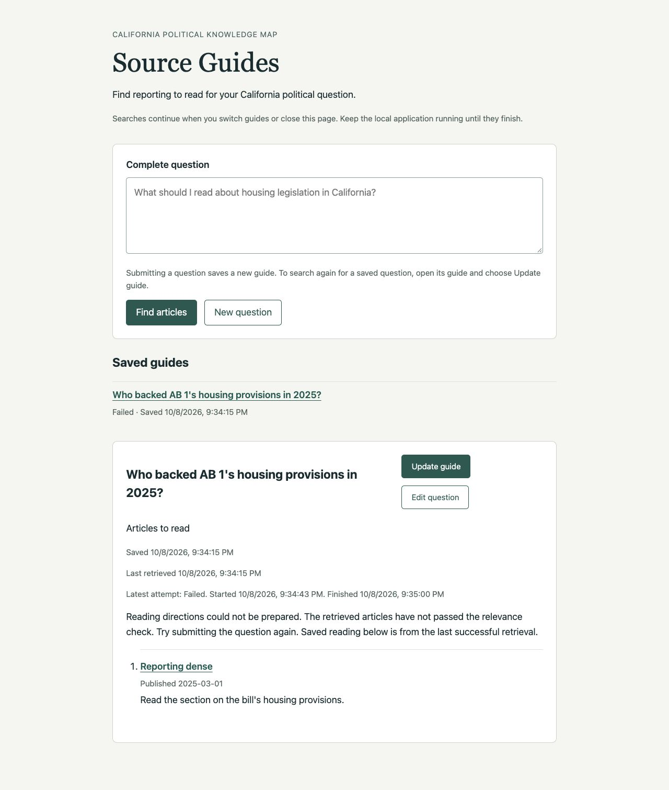
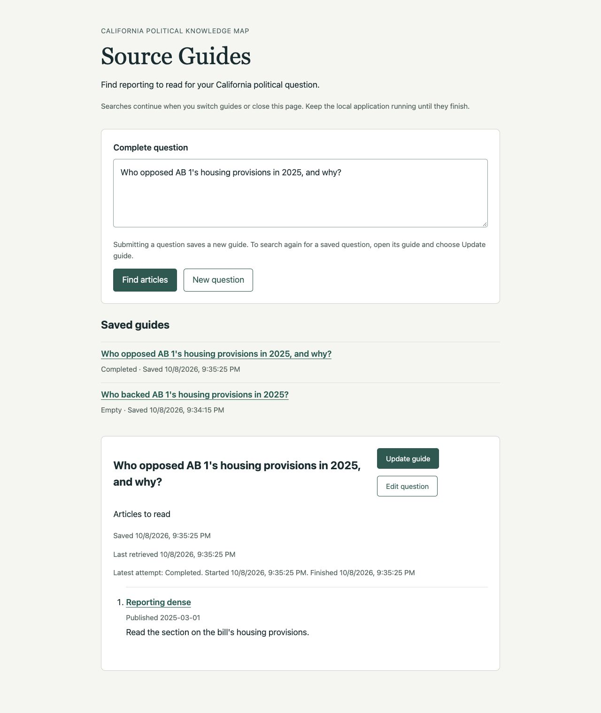

# Ticket 04 validation

Fixed point: `487712edcdf7f6ae92748f4279be12143d7ab907`.

## Test seams

The primary seam is the FastAPI application over HTTP/ASGI with temporary real
SQLite, the real Chat Session, and deterministic model and retrieval substitutes.
Explicit events control pending work. HTTP reads observe identities, content,
attempt outcomes, and timestamps. No test inspects task registries or SQL rows,
and no independent Chat Session seam is added. The ticket conductor authorizes
choosing these seams without another confirmation.

As in ticket 03, the public `SQLiteGuideStore.finish` operation is the
supplementary seam for submitting a retired attempt's completion. Its effects
are observed through HTTP. The real execution remains held by an explicit event
until after the stale-publication check.

The browser additionally verifies Edit question, explicit Update guide, retained
reading, and visible saved-content versus latest-attempt timing.

Same-guide updates use `POST /api/guides/{guide_id}/update`. Only one attempt may
run for a guide at a time. A conflicting update returns HTTP 409; the reader can
request another update after completion. Each accepted update gets a distinct
attempt identity. This implements serialization without adding a queue.

## Red-green evidence

1. The same-guide update test failed with HTTP 404. The new route and the
   transactional `start_update` operation made the identity, pending retention,
   and successful replacement assertions pass.
2. The failed-update test failed because the latest attempt exposed no assessment
   of its own. Its safe assessment and message now accompany its status and
   timing, independently of saved content's earlier assessment and message.
3. The update security test failed because a simple text POST started an update.
   The route now requires JSON and an empty object, rejecting attempts to change
   the question or runtime model. It retains the local-host boundary.
4. Browser verification found no Update guide control on completed reading.
   The new control starts the explicit operation, remains disabled while it
   runs, and leaves saved reading visible with separate attempt timing.

Existing completion guards and new-question submission already supported empty
replacement, retired completion rejection, and independent edited questions.
Additional HTTP tests verify those paths with the new update operation.

## Implemented behavior

An accepted update returns HTTP 202 and the same guide identity, complete saved
question, and creation time with a fresh running attempt. SQLite reserves the
write transaction before checking the current attempt and changing its identity.
A second update receives HTTP 409 while that attempt runs. Once it finishes, an
explicit new request can proceed. This permits one attempt at a time without a
queue or an implicit replay.

The existing completion transaction changes content and retrieval information
together, only for the guide's active running attempt. Successful empty results
replace previous articles. Failed updates retain saved reading and its original
retrieval date while recording the latest failure and timing. The latest
attempt's reader projection includes only the existing typed question assessment
and safe presentation message. It includes no retrieved evidence or provider
diagnostics.

The reader distinguishes the saved content's retrieval date from the latest
attempt's start, finish, and outcome. The selected guide stays readable during
updates. Edit question restores the full text, and submitting it uses the
existing direct-question path to save a separate guide. Form guidance explains
the difference between submission and Update guide. Reading, polling, opening,
and navigation still issue only GET requests. Ingestion has no guide-execution
hook and is unchanged.

## Acceptance evidence

| Criterion | Evidence |
| --- | --- |
| Same identity and question; reading retained while running | `test_update_keeps_identity_and_reading_until_new_content_is_published` holds the update model behind an event, reads the same guide and creation time, preserves previous articles and retrieval time, then observes new content. |
| Atomic successful replacement, including empty | The same test verifies replacement and identical retrieval/finish times. `test_conflicting_updates_wait_for_completion_and_empty_update_replaces_reading` then publishes an empty third attempt, removes previous articles, and advances the retrieval time. |
| Failure retains saved content and retrieval date; latest timing stays separate | `test_failed_update_preserves_saved_reading_and_its_retrieval_date` retains the earlier articles, assessment, message, and retrieval date while exposing the latest failure, assessment, and start/finish times. A new application instance over the same SQLite file restores the exact result. Browser checks confirm the distinction. |
| Edit creates an independent guide with explicit wording | `test_edited_complete_question_creates_an_independent_guide_without_rewriting` observes distinct guide and attempt identities and the exact submitted wording at the model boundary, with the original guide unchanged. The browser verifies full-text restoration and both saved guides. |
| Conflicting updates serialize; retired attempts cannot publish | Two concurrent HTTP update requests produce one 202 and one 409. The accepted attempt preserves reading until released; a later update succeeds. All three accepted attempts have distinct identities. Public completion calls using retired identities leave the current HTTP detail unchanged both while the newer attempt runs and after empty publication. |
| No implicit updates | Repeated HTTP reads and a new application instance issue no extra model questions. Browser navigation and reload leave the controlled log at exactly three explicit executions of the original question and one edited submission. Ingestion code and its lack of guide-execution hooks remain unchanged. |

`test_update_rejects_simple_cross_origin_posts_and_question_or_model_overrides`
also verifies HTTP 415 for a simple POST, 422 for question/model overrides,
421 for a nonlocal host, 404 for a missing guide, and 503 after application
shutdown. Rejected requests leave saved content and model activity unchanged.

## Browser verification

The Codex in-app browser used `http://127.0.0.1:8934` with the real application,
a temporary SQLite file, and deterministic model and retrieval dependencies.
The disposable runner lives under `.scratch/`. Local control endpoints release
async events; they are absent from production code.

- Submitted `Who backed AB 1's housing provisions in 2025?` and reopened its
  saved URL after the initial successful article selection.
- Selected Update guide. The guide identity and reading stayed visible, its
  Update control became disabled, and the old retrieval time remained beside
  a new Running attempt time and explicit retained-reading notice.
- Selected New question while the update ran, released its controlled failure,
  then reopened and reloaded the original guide. It displayed Failed with
  separate latest start/finish times while keeping its original article and
  last successful retrieval date.
- Requested another update and released a successful empty result. Without
  reloading, the article disappeared, the empty outcome appeared, and the
  retrieval time advanced to match the new finish time.
- Selected Edit question. The complete original question returned to the
  editable input. Changed it to `Who opposed AB 1's housing provisions in 2025,
  and why?` and submitted directly. A second guide identity appeared and both
  questions remained in Saved guides. Reopening the original restored its
  empty result and prior retrieval date.
- The controlled model log contained exactly the original question three times
  and the edited question once. Navigation, reload, and reopening caused no
  extra search. The browser layout was also inspected visually.

These controlled checks establish application behavior, not live-corpus
relevance accuracy. They use no live model or changing publisher page.
The disposable browser tab and server were closed after verification.

## Scope and checks

Provider admission, shared retrieval limits, prompts, historical evaluations,
and article-link safety are unchanged. Cancel remains ticket 05. Startup
interruption reconciliation, including cancellation before coroutine entry,
and Retry remain ticket 06. No new ADR or domain definition was required.

All commands used `uv`, with `UV_CACHE_DIR=/tmp/source-guides-uv`. Type tooling
also used `UV_TOOL_DIR=/tmp/source-guides-tools` and cached offline execution.

- Focused update, web, execution, lifecycle, and correction tests: 48 passed.
- `uv run --no-sync pytest -q tests`: 1514 passed, 61 skipped, one existing OpenRouter reasoning/temperature warning, 49.33 seconds. Existing local HTTP tests ran with approved loopback permission.
- `uv run --no-sync node --test tests/chat_eval_review_editing.test.mjs tests/rag_eval_review.test.mjs tests/chunk_eval_review.test.mjs`: 29 passed.
- `uv tool run --offline --from ty ty check src/knowledge_map/web.py src/knowledge_map/adapters/source_guides.py src/knowledge_map/schemas/source_guides.py`: passed.
- `uv run --no-sync ruff check` over the changed Python modules and new tests: passed.
- `uv run --no-sync node --check src/knowledge_map/resources/source-guides/guide.js`: passed.
- `git diff --check`: passed.

No ticket 04 blocker remains. Acceptance checkboxes and tracker state remain
for the independent reviewer to reconcile.
