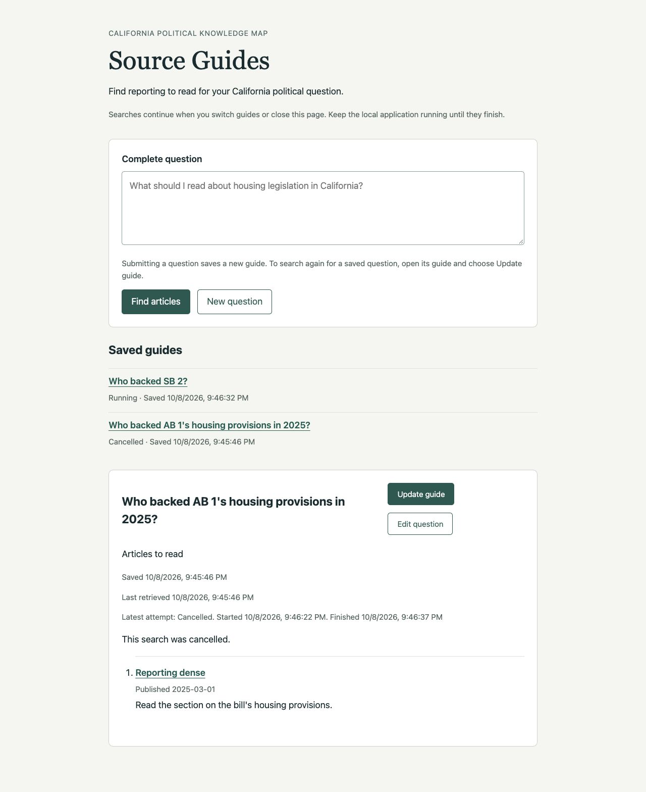
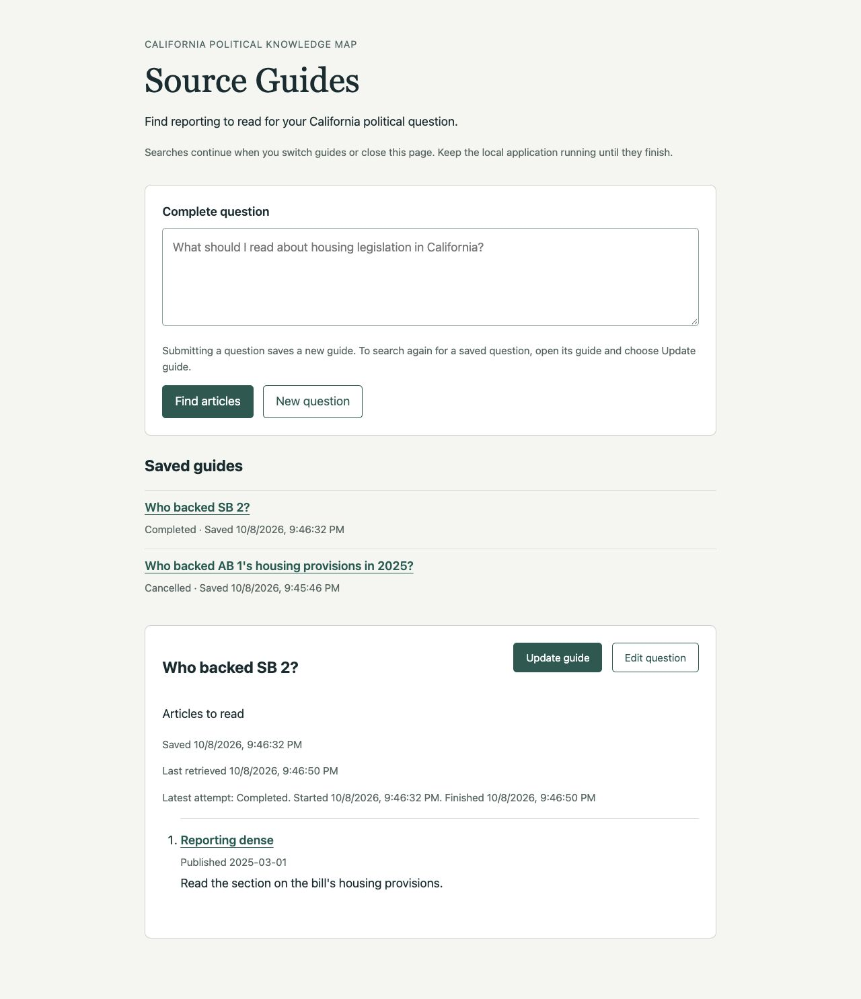
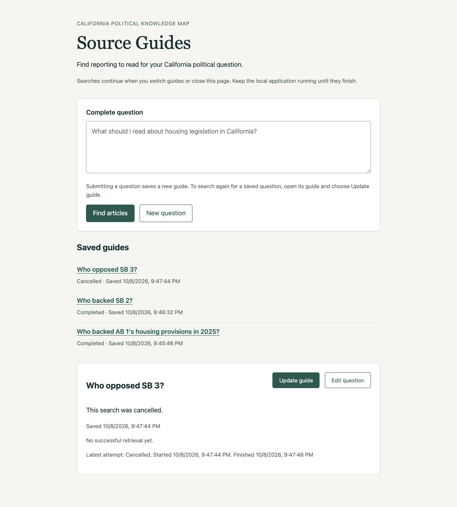

# Ticket 05 validation

Fixed point: `c71ccb25539fcb1a0cd5aca04e64765a7e2ebb64`.

## Test seams

The primary seam is the FastAPI application over HTTP/ASGI with temporary real
SQLite, the real Chat Session, and deterministic external model and retrieval
substitutes. Explicit events control running work. Tests observe saved questions,
content, attempt outcomes, and timestamps through HTTP. They inspect no private
task registry or SQL rows and add no independent Chat Session tests. The ticket
conductor authorizes choosing these seams without another confirmation.

The existing public `SQLiteGuideStore.finish` operation is the supplementary
seam for forcing late completion and completion/cancellation ordering. Its
effects are observed through HTTP while real execution remains event-controlled.
The browser verifies Cancel, retained reading, and independent guide progress.

Cancellation uses `POST /api/guides/{guide_id}/attempts/{attempt_id}/cancel`
with an empty JSON object. The attempt identity binds the action to the search
the reader saw. The response returns the saved guide after the operation.
Completed or retired attempts remain unchanged, so a delayed Cancel cannot
stop a newer update. Cancel records its terminal outcome before stopping local
work; the existing completion transaction arbitrates publication and cancellation.

## Red-green evidence

1. The initial-cancellation HTTP test failed with 404. Adding the cancellation
   route and looking up local execution by attempt identity made it pass. The
   response records `cancelled` and a finish time before local cancellation.
2. The browser showed a running guide with no Cancel control. Adding the control
   and its attempt-specific request enabled cancellation for an initial search
   and an update. Saved reading remained visible during and after the update.
3. The initial-cancellation browser check exposed the same message twice.
   The reader now suppresses a message identical to its outcome label; reload
   confirmed the cancellation sentence appears once.

The subsequent HTTP slices passed using the existing transactional completion
guard: retained update content, rejected late publication, stale Cancel requests,
independent guides, both terminal orderings, concurrent completion/cancellation,
and admission checks. No new storage operation or schema was needed.

## Implemented behavior

The Cancel control appears only while the selected guide's latest attempt is
running. Its request captures that attempt's identity. An empty JSON object and
the existing local-host boundary are required. A valid operation returns HTTP
200 and the current saved guide. Missing guides return 404. Completed, retired,
and wrong-guide attempt identities leave the guide unchanged and return its
current state. This lets a late request show the actual outcome instead of
claiming that it cancelled a completed search or stopping a newer attempt.

The existing `finish` transaction updates only a running, latest attempt belonging
to the guide. It commits the cancelled outcome and finish time without changing
previous content or retrieval information. Only then does the application cancel
the local task with that attempt identity. The executor's shutdown/exception
paths and any later completion use the same guarded transaction, so none can
replace the cancelled outcome. If completion wins first, cancellation leaves the
complete content and terminal timing unchanged. Content and retrieval timing
remain committed together.

After the response, the reader rejects pending poll responses from the earlier
selection, displays the saved result, and enables Update guide. A new explicit
update creates another attempt. Reopening only reads persisted values.

## Acceptance evidence

| Criterion | Evidence |
| --- | --- |
| Cancel targets the specific running attempt | The browser exercises Cancel on an update and an initial search. `test_cancel_is_bound_to_one_attempt_while_another_guide_continues` rejects a different guide's attempt identity. The update test also sends an older Cancel during a newer active attempt and observes no change. |
| Durable cancelled outcome, timing, question, and previous reading/retrieval information | `test_cancel_initial_search_persists_question_outcome_and_timing_without_replay` checks unchanged identity, question, creation/start times, cancelled outcome, and finish time. `test_cancel_update_retains_reading_rejects_late_results_and_allows_explicit_update` separately checks unchanged articles, assessment, message, and last retrieval time alongside the cancelled attempt's later timing. Both restore the exact guide from a new application instance over the same SQLite file. |
| Late completion cannot publish or replace cancelled state | Initial and update tests submit a late empty completion through the public store operation and observe the unchanged cancelled guide through HTTP. The race test submits a full late result after cancellation and preserves the original articles, partial flag, and retrieval date. |
| Other guides continue independently | The isolation test holds two initial searches, cancels one, releases the other, and observes Cancelled and Completed guides with independent content. Browser checks show the same outcome. |
| Cancellation/completion races have one consistent terminal outcome | `test_cancel_and_completion_publish_one_consistent_terminal_result` covers cancellation first, completion first, and a threaded completion concurrent with the HTTP operation. HTTP response/read values agree; content, partial flag, retrieval time, outcome, and terminal time form either the retained cancelled guide or the complete new result. Repeated operations and a new application instance preserve that exact result. |
| Reopening does not replay; explicit Update remains available | Initial and update tests restore cancelled state without another model question. The update test explicitly starts a fresh attempt after reopening, rejects stale cancellation/completion against its predecessor, and publishes new reading. Browser reload and explicit Update confirm the controls and behavior. |

`test_cancel_preserves_json_and_loopback_admission_boundaries` verifies 415 for a
simple text POST, 422 for attempt/question/model overrides, 421 for a nonlocal
host, 404 for a missing guide, and 503 after shutdown. Rejected requests leave the
running guide unchanged.

## Browser verification

The Codex in-app browser used `http://127.0.0.1:8935` with the real application,
temporary SQLite, and deterministic model/retrieval dependencies. The disposable
runner `.scratch/ticket-05-browser.py` exposes local event-release controls absent
from production code.

- Submitted `Who backed AB 1's housing provisions in 2025?` and obtained an article.
- Chose Update guide. The original reading and retrieval date remained visible;
  the latest attempt showed Running with Cancel and a disabled Update control.
- Started `Who backed SB 2?` while the original update remained running.
- Reopened the original and selected Cancel. The latest attempt showed Cancelled
  with its start and finish times. The original article and retrieval date stayed
  visible, Cancel disappeared, and Update guide became enabled. SB 2 stayed Running.
- Released the controlled SB 2 search and reopened it. It showed Completed with
  an article while the original remained Cancelled in Saved guides.
- Reopened and reloaded the original. Its cancelled state and reading returned.
  Explicit Update guide started a fresh attempt that completed after release.
- Submitted `Who opposed SB 3?`, selected Cancel, and reloaded. Its question,
  cancelled timing, and no-successful-retrieval state remained visible, with no
  article and an enabled Update control.
- The controlled model log held exactly five explicit executions: the original
  submission, its cancelled update, SB 2, the original's later update, and SB 3.
  Navigation, polling, and reload caused no additional search.

These checks establish application behavior using controlled outcomes. They make
no claim about live-model relevance accuracy or undoing an issued provider
request. The temporary browser tab and loopback server were closed.

## Scope and checks

Only cancellation, its reader control, and focused tests/documentation changed.
Storage schema, prompt versions, shared retrieval, provider configuration, and
historical evaluations are unchanged. Startup interruption reconciliation and
Retry remain ticket 06, including shutdown before coroutine entry. No new ADR
or domain definition was needed.

All commands used `uv`, with `UV_CACHE_DIR=/tmp/source-guides-uv`. Type tooling
also used `UV_TOOL_DIR=/tmp/source-guides-tools` and cached offline execution.

- Focused cancellation, update, execution, web, lifecycle, and correction suite:
  55 passed.
- `uv run --no-sync pytest -q tests`: 1521 passed, 61 skipped, one existing
  OpenRouter reasoning/temperature warning, 49.58 seconds. Existing local HTTP
  tests ran with approved loopback permission.
- `uv run --no-sync node --test tests/chat_eval_review_editing.test.mjs tests/rag_eval_review.test.mjs tests/chunk_eval_review.test.mjs`: 29 passed.
- `uv tool run --offline --from ty ty check src/knowledge_map/web.py src/knowledge_map/adapters/source_guides.py src/knowledge_map/schemas/source_guides.py`: passed.
- `uv run --no-sync ruff check src/knowledge_map/web.py tests/test_source_guide_cancellation.py`: passed.
- `uv run --no-sync ruff format --check src/knowledge_map/web.py tests/test_source_guide_cancellation.py`: passed.
- `uv run --no-sync node --check src/knowledge_map/resources/source-guides/guide.js`: passed.
- `git diff --check`: passed.

No ticket 05 blocker remains. Acceptance checkboxes and tracker state remain for
the independent reviewer.
