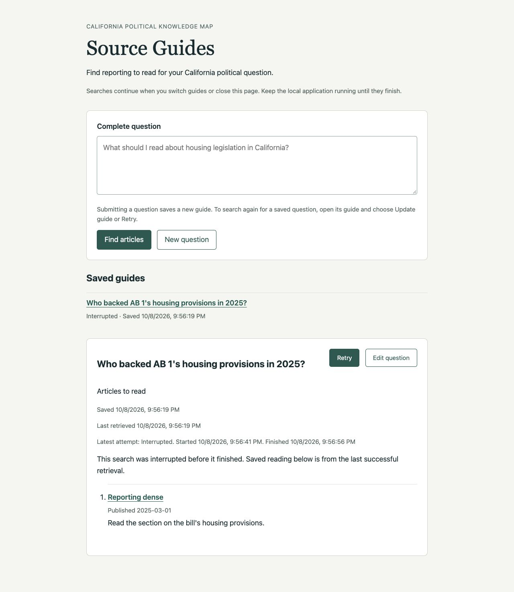
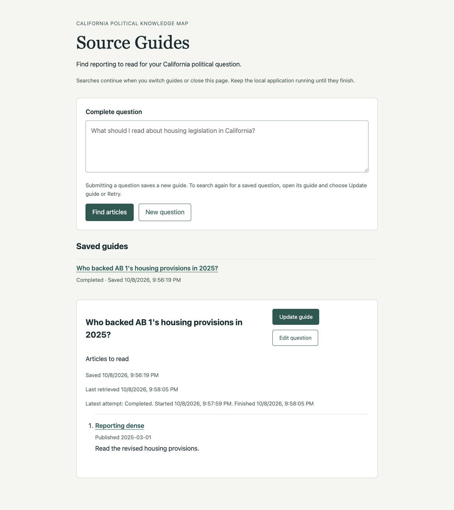
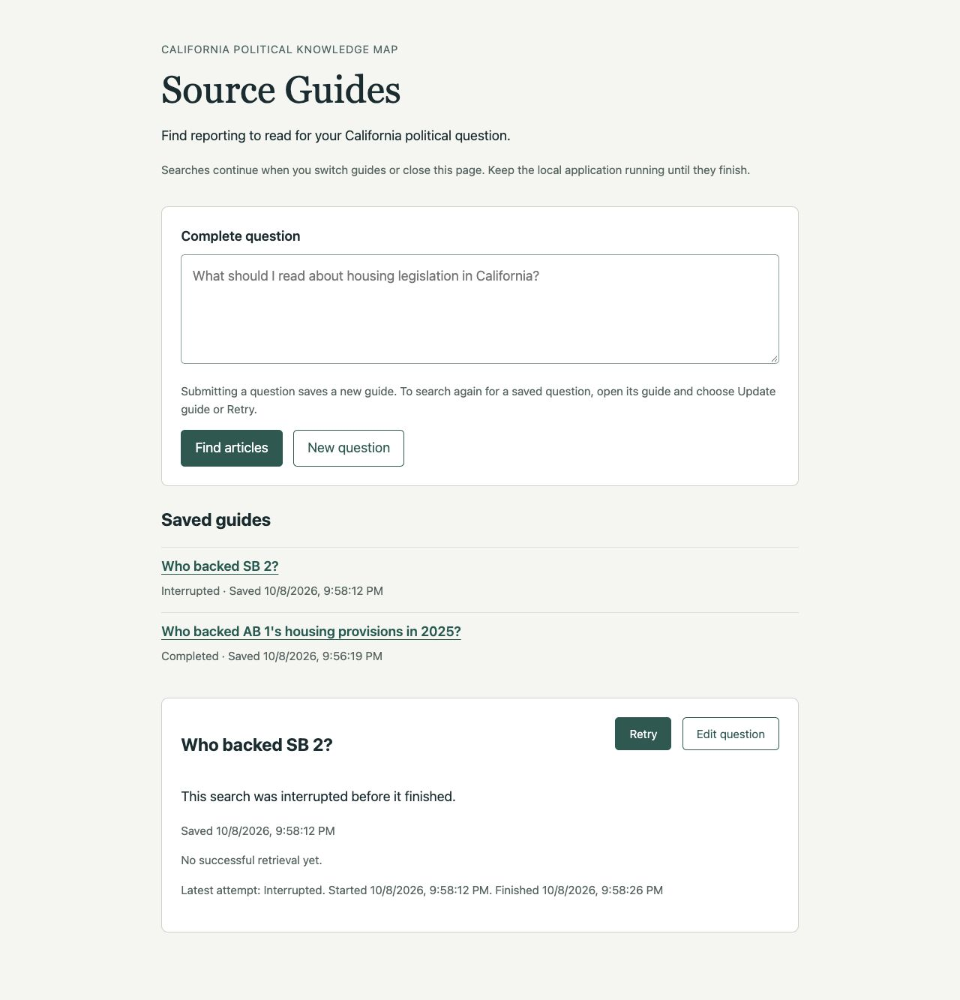
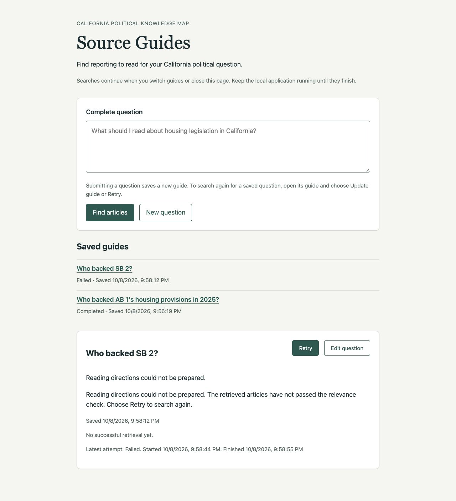

# Ticket 06 validation

Fixed point: `6a1040cd3ccd55ecfd03acdef4caf2692b6000a7`.

## Test seams

The primary seam is the FastAPI application over HTTP/ASGI with temporary real
SQLite, the real Chat Session, and deterministic external model and retrieval
substitutes. Events control active executions. Successive application lifespans
prove restart behavior through saved HTTP responses. Tests inspect no private
execution registry or SQL rows and add no independent Chat Session tests.
The ticket conductor authorizes selecting these seams without confirmation.

The supplementary public `SQLiteGuideStore.finish` operation forces obsolete
completions; HTTP reads observe whether those attempts can publish. Browser
verification interrupts the local service, reopens the same guide after restart,
and explicitly retries using controlled outcomes.

Retry uses the existing `POST /api/guides/{guide_id}/update` operation with an
empty JSON object. The reader labels this action Retry when the latest attempt
failed or was interrupted. The operation creates a new execution for the same
saved question and guide, using existing admission and publication guards.

## Red-green evidence

1. The startup regression test submitted a question over HTTP and ended the
   application lifespan before its execution entered the model. A new instance
   over the same SQLite file returned `running`, failing the required
   `interrupted` assertion. Startup now calls `interrupt_unfinished` before
   accepting new searches. The same test passes and observes no model request
   across repeated listing, opening, page loads, and a second restart.
2. The next HTTP slice established that an interrupted update retains the
   previous reading and retrieval date. Explicit Retry first fails, then a later
   Retry succeeds. Existing update admission and completion guards passed without
   further storage changes, including rejection of obsolete results before and
   after the successful retry.
3. The mixed-store startup slice passed with completed, empty, Declined, and
   Deferred records unchanged while two unfinished initial questions became
   interrupted. The existing unsuccessful-guide restart tests also pass.
4. The browser initially showed an interrupted guide with only Update guide.
   The reader now labels that action Retry for failed or interrupted attempts.
   Reload confirmed Retry, and clicks exercised failed and successful retries.
   Interrupted updates also explain that visible reading belongs to the last
   successful retrieval. Newly recorded execution failures direct readers to
   Retry. Persisted earlier failure messages retain their original wording.

## Implemented behavior

Startup scans saved guides after dependencies open and before accepting requests.
For each running latest attempt it records an interrupted outcome through the
existing guarded completion transaction. That operation retains the question,
creation time, attempt identity and start time, saved content, and successful
retrieval time. It adds the terminal outcome and finish time. The finish time
records when interruption was recognized, not an inferred process-crash time.
A later startup leaves the terminal outcome and its timing unchanged.

Retry has the same semantics as an explicit update. It returns HTTP 202 with a
new attempt identity for the same guide and question. A concurrent active attempt
still returns 409; body validation and the local-host boundary remain in force.
The previous content remains available while searching and after failure.
Successful content and its retrieval time publish together. The existing
transaction accepts only the guide's running latest attempt, so a retired
interrupted or failed attempt cannot replace the retry's pending or completed
state. A completed empty result retains the existing empty-publication behavior.

The reader exposes Retry only for failed/interrupted latest attempts. After a
retry starts, the ordinary running controls appear; completion restores Update
guide. Listing, opening, polling, reload, and startup only read or reconcile
saved state. They create no searches or model requests. The implementation adds
no replay, refresh, or checkpoint mechanism.

## Acceptance evidence

| Criterion | Evidence |
| --- | --- |
| Startup interrupts unfinished attempts and preserves saved values | `test_startup_interrupts_accepted_search_that_stopped_before_model_entry` reproduces the deferred ticket 03 edge. It verifies unchanged guide/question/creation/attempt/start values, a recorded interrupted outcome and finish time, and no retrieval time for an initial search. `test_restarted_update_retries_without_losing_reading_or_accepting_old_results` verifies that an interrupted update retains articles, assessment, and last retrieval time. |
| Failed/interrupted guides offer Retry and create fresh execution identities | Browser checks use Retry on interrupted and failed initial searches and updates. The retry HTTP test keeps guide/question/creation identity and observes four distinct attempt identities across the initial completion, interrupted update, failed retry, and completed retry. |
| Retry retains prior content while running/on failure and publishes success atomically | The retry HTTP test holds model execution with events, observes the old articles/date, releases a guidance failure, and observes the same articles/date again. The next explicit retry publishes revised reading and a later retrieval time equal to its finish time. Existing update tests cover successful empty replacement. |
| Restart, list, open, reload cause no automatic replay | The pre-entry test repeats read/list/page loads and a second startup with zero model requests. The retry test observes no additional execution across successive instances until an explicit POST. Browser model logs contain exactly the seven explicit submissions, updates, and retries. |
| Terminal eligibility/outcomes remain terminal; obsolete attempts cannot publish | `test_startup_preserves_terminal_guides_while_interrupting_unfinished_questions` preserves completed, empty, Declined, and Deferred records exactly while interrupting two pending questions. The retry test submits obsolete interrupted and failed completions through the public store operation and observes unchanged HTTP content/status/timestamps during and after the new retry. Existing failed/cancelled restart tests also pass. |

## Browser verification

The Codex in-app browser used `http://127.0.0.1:8936` with the real application,
real temporary SQLite, and deterministic external model/retrieval behavior.
The disposable runner `.scratch/ticket-06-browser.py` logs each assessed question
and provides an explicit event-release endpoint absent from production.

- Submitted `Who backed AB 1's housing provisions in 2025?`; it completed with
  reading and a last-retrieved time of 9:56:19 PM Pacific.
- Chose Update guide. The original article and retrieval time stayed visible.
  The latest attempt started at 9:56:41 PM and remained running inside the
  controlled model request.
- Stopped that temporary process with SIGKILL, restarted the same application
  and SQLite file, and reloaded the guide. It showed Interrupted, started at
  9:56:41 PM and finished at 9:56:56 PM. The original reading and 9:56:19 PM
  retrieval time remained. Reload after the reader change showed Retry and
  explained the age of the saved reading.
- Selected Retry. While running, the original article remained available. An
  explicit release caused the controlled guidance failure. The guide showed
  Failed and Retry, with its original reading and retrieval time intact.
- Selected Retry again and released the controlled search. The same guide
  showed Completed with revised reading and a last-retrieved time of 9:58:05 PM,
  matching the latest attempt's finish time. Reload retained that result.
- Submitted `Who backed SB 2?`, then killed the service while its initial search
  waited. Restart and reload restored the same question with Interrupted, Retry,
  a finish time, and `No successful retrieval yet.` The completed AB 1 guide
  remained Completed.
- Selected Retry for SB 2, released a controlled failure, and observed Failed
  with Retry and the current `Choose Retry to search again.` message. A second
  explicit Retry completed after release. Reload showed its first successful
  retrieval at 9:59:07 PM.
- The model log recorded exactly four AB 1 executions and three SB 2 executions.
  No restart, listing, reopening, polling, or reload added an execution.

All browser times are from 2026-10-08 Pacific. The final AB 1 guide retained
identity `10d3b80a-b7e3-4557-afc1-4bbc330268a8`; the final SB 2 guide retained
identity `bcb68824-6d9a-449f-998a-9dbf381fde06`.

The controlled checks establish application behavior, not live-model relevance
accuracy. Browser and loopback-server cleanup followed verification.

## Scope and checks

The change adds startup interruption reconciliation and reader Retry behavior.
It uses the existing single local application ownership, update operation,
SQLite schema, and guarded completion transaction. It changes no model prompts,
retrieval policy, historical evaluations, or domain vocabulary. No ADR is needed.
Ticket checkboxes and tracker reconciliation remain for the independent reviewer.

All checks use uv with `UV_CACHE_DIR=/tmp/source-guides-uv`. Type tooling also
uses `UV_TOOL_DIR=/tmp/source-guides-tools` and cached offline execution.

- Focused recovery, cancellation, update, execution, web, lifecycle, and
  correction suite: 58 passed.
- `uv run --no-sync node --test tests/chat_eval_review_editing.test.mjs tests/rag_eval_review.test.mjs tests/chunk_eval_review.test.mjs`: 29 passed.
- `uv tool run --offline --from ty ty check src/knowledge_map/web.py src/knowledge_map/adapters/source_guides.py src/knowledge_map/schemas/source_guides.py`: passed.
- `uv run --no-sync ruff check src/knowledge_map/web.py src/knowledge_map/adapters/source_guides.py tests/test_source_guide_recovery.py`: passed.
- `uv run --no-sync ruff format --check src/knowledge_map/web.py src/knowledge_map/adapters/source_guides.py tests/test_source_guide_recovery.py`: passed.
- `uv run --no-sync node --check src/knowledge_map/resources/source-guides/guide.js`: passed.
- `git diff --check`: passed.
- `uv run --no-sync pytest -q tests`: 1524 passed, 61 skipped, one existing
  OpenRouter reasoning/temperature warning, 47.46 seconds. Existing local HTTP
  tests ran with approved loopback permission.

No ticket 06 blocker remains.
