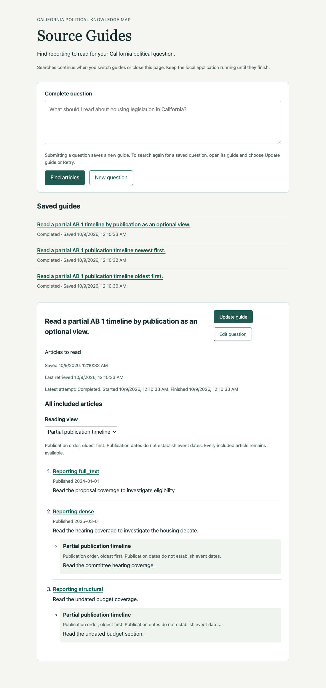

# Ticket 07 independent review

Reviewed on 2026-10-09 UTC against fixed point
`9d6fa3c47dd0a410a02c519639639dbe50913f55` using
`git diff 9d6fa3c47dd0a410a02c519639639dbe50913f55...HEAD`.
Implementation commit: `561eb88fd492dacc7ace4e9755b0389f006aa9ab`.
Separate parallel Standards and Spec reviewers used the repository's code-review
skill. Neither reviewer authored the implementation.

The review read AGENTS.md, GLOSSARY.md, tracker/domain conventions, relevant ADRs
including 0017, 0019, 0022, and 0023, ticket 07, the parent PRD, the full
[implementation evidence](ticket-07.md), and the implementation diff. The latest
maintainer clarification governs acceptance: each included article has one
ordinary link, with group-labeled directions nearby. Verified highlight links
remain ticket 08.

## Standards

No documented-standard violations. One low-priority judgment-based smell.

- Duplicated Code / Shotgun Surgery: `QuestionAssessment.reading_order` and
  `ArticleGroup.order` independently declare the same five reading-order values.
  A new supported order would require synchronized schema edits. A shared
  `ReadingOrder` type alias should own that vocabulary.

The change follows domain terminology, reuses shared Chat Agent execution and
typed answers, preserves existing prompt versions and historical reports, and
stores no Article Chunk bodies in guide groups. The smell is a maintainability
judgment, not a documented rule violation.

## Spec

One P2 finding.

- A valid partial publication timeline places its members ahead of every
  nonmember. Selecting a timeline containing 2024 and 2025 articles in a guide
  that also includes a 2020 article renders 2024, 2025, 2020 while claiming
  "Publication order, oldest first." This violates ticket 07's "Preserve
  requested chronology" and the PRD's "honor requested chronological
  organization." Sort the complete displayed list by publication date.

The remaining criteria are implemented: typed optional groups, final included
source filtering, repeated distinct memberships, identical-entry consolidation,
one ordinary article link, nearby directions, separate publication/event dates,
group-free fallback, failure distinctions, persistence, complete relevance order,
immutable prompts, and historical evaluation compatibility. No scope finding.

## Dispositions and acceptance

Both findings are accepted and fixed. The shared `ReadingOrder` alias now serves
both schemas without changing supported values or defaults. Publication timeline
selection now sorts every included article by citation publication date in the
selected direction, with undated reading last. Group membership still determines
which nearby directions are emphasized. Contrast and event views retain their
membership-specific organization.

The Standards reviewer rechecked the alias and confirmed resolution without new
findings. The Spec reviewer reran production rendering with partial timelines
in both publication directions and confirmed complete chronological order and
restoration of relevance order. There are no rejected, duplicate, out-of-scope,
or unresolved findings, and no question requiring maintainer input.

All seven ticket criteria are checked. Ticket 07 has exactly one triage-state
label, `completed`. The authoritative work README lists tickets 01 through 07
as completed and 08 through 09 as takeable. The parent project remains
`ready-for-agent`.

## Browser correction verification

The review visually inspected the four final article-once implementation PNGs.
Historical pre-clarification images and Evaluation Reports remain unchanged.

After the reader correction, the already-installed Python Playwright package
and cached headless Chromium exercised the real application on loopback, with
temporary real SQLite and deterministic external model/retrieval substitutes.
Commands used uv, a 45-second overall bound and five-second control waits. No
computer-use or native Chrome acquisition was retried, and no runtime installed.
The temporary server and browsers were closed afterward.

- Partial oldest-first timeline: an included 2024 article omitted from the group
  appears before the grouped 2025 article, followed by undated reading.
- Partial newest-first timeline: the 2025 article appears before the omitted
  2024 article, followed by undated reading.
- Optional publication timeline on a relevance-default guide also sorts the
  complete list correctly when selected.
- Each partial case has three unique ordinary article links and two nearby
  membership directions. Reload retains the guide; selecting the timeline again
  preserves publication order, and Relevance restores the original complete order.
- The existing 12-view check passed again across contrast, publication, event,
  ungrouped and reopened contrast views. It checks unique ordinary links,
  nearby directions, literal malicious markup, absence of chunk text, publication
  and evidence-supported event dates, and an actual controlled article popup.

## Final checks

All Python/Node commands use uv and `UV_CACHE_DIR=/tmp/source-guides-uv`.
Cached type tooling also uses `UV_TOOL_DIR=/tmp/source-guides-tools`.

- Focused HTTP, group, shared evaluation and prompt checks: 73 passed. One
  existing Pydantic Evals event-loop deprecation warning.
- `uv run --no-sync pytest -q tests`: 1537 passed, 61 skipped, one existing
  OpenRouter reasoning/temperature warning, 55.12 seconds after the final fixes.
  Existing local HTTP tests ran with approved loopback permission.
- `uv run --no-sync node --test tests/chat_eval_review_editing.test.mjs tests/rag_eval_review.test.mjs tests/chunk_eval_review.test.mjs`: 29 passed.
- `uv tool run --offline --from ty ty check` over all six changed application
  modules: passed.
- `uv run --no-sync ruff check` over changed application modules, tests and
  controlled evaluation runner: passed.
- `uv run --no-sync node --check src/knowledge_map/resources/source-guides/guide.js`: passed.
- Ticket labels, checked criteria, evidence links and remaining frontier: passed.
- `git diff --check`: passed.

Standards: one judgment-based finding, fixed; no documented violations.
Spec: one P2 finding, fixed. No valid finding remains unresolved.
