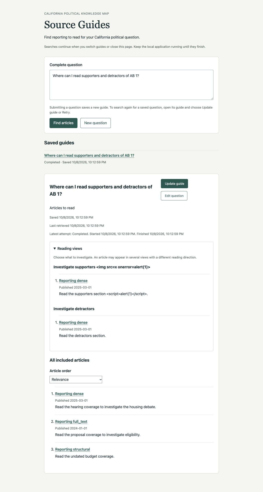
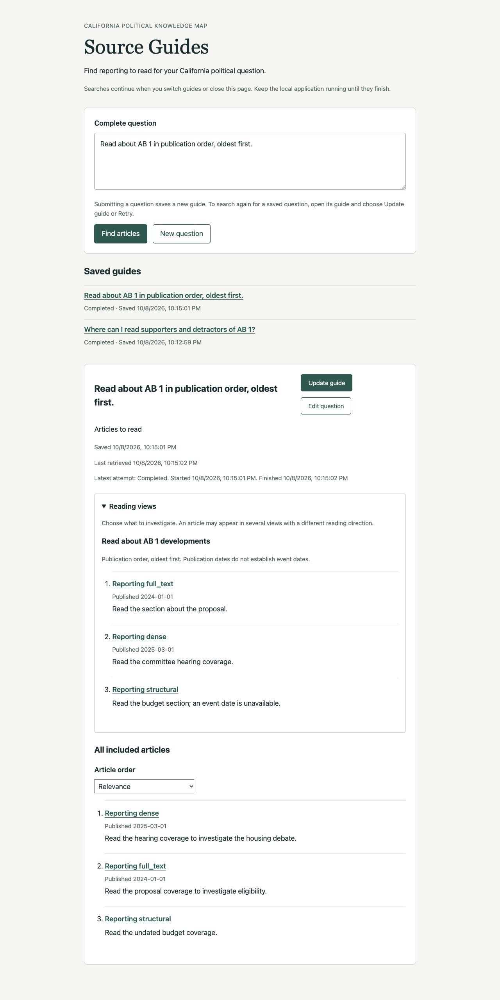
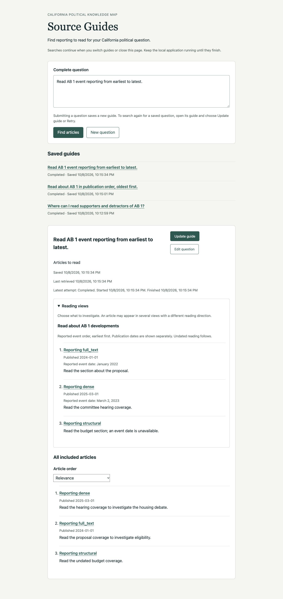
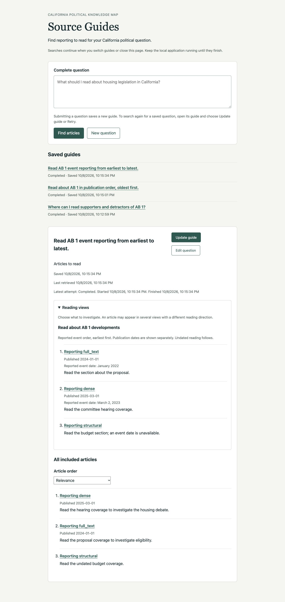
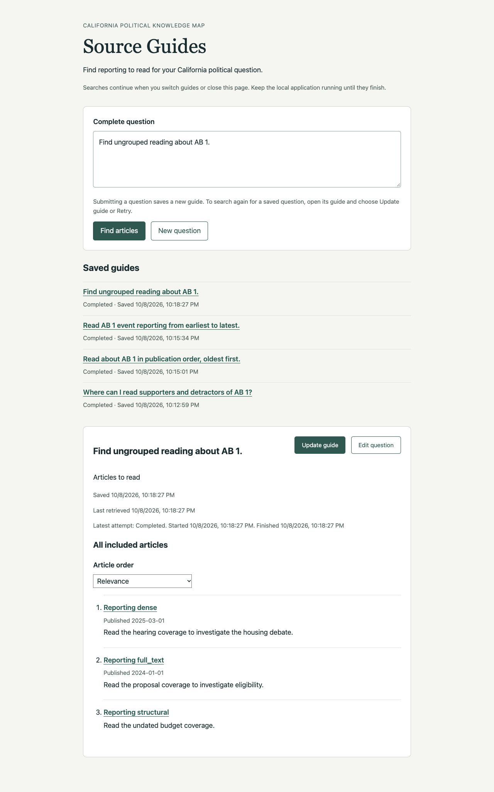
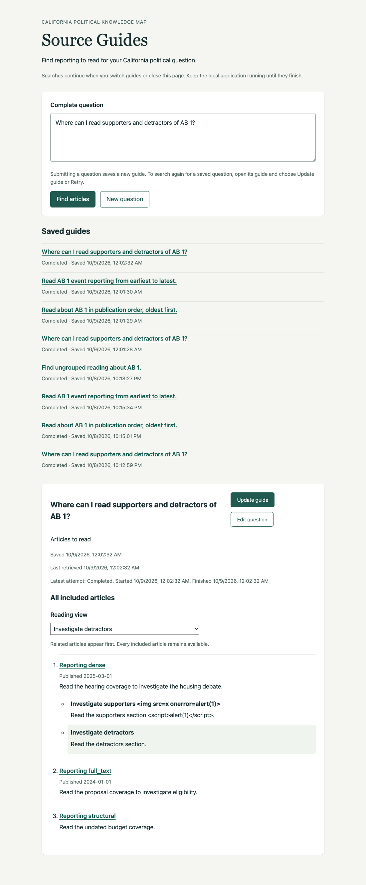
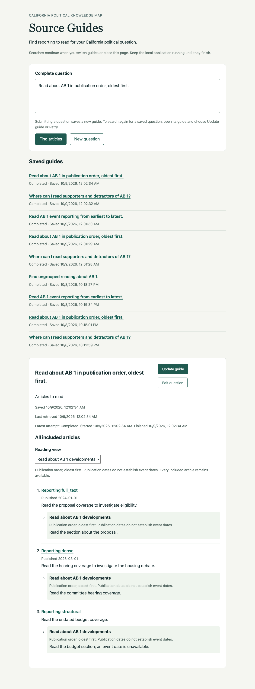
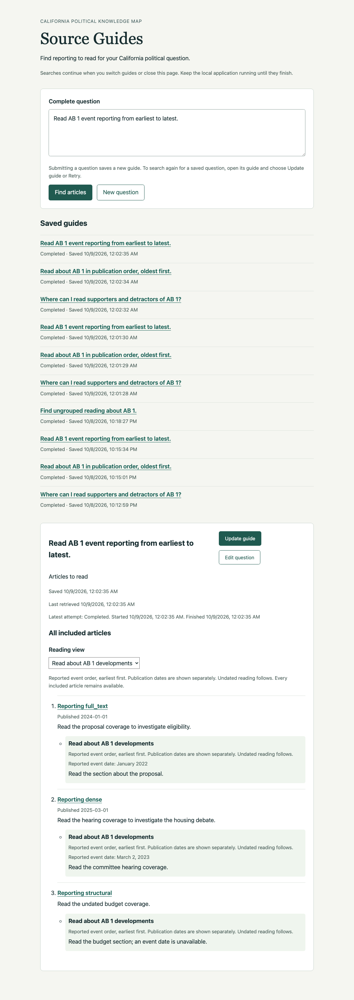
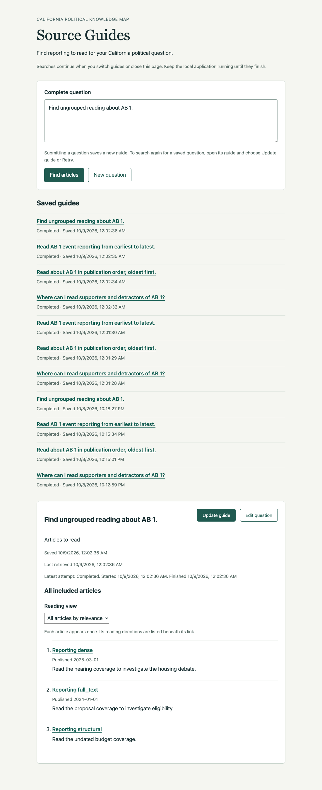

# Ticket 07 implementation evidence

Implementation base: `9d6fa3c47dd0a410a02c519639639dbe50913f55`.
Verification date: 2026-10-09 UTC. Independent review owns ticket acceptance.

The maintainer resolved the rendering question with: "An article should always
appear once as a non-highlighted link and if we have them, a list of relevant
highlights should appear in close proximity." The final reader uses one ordinary
link per included article, followed by its group-labeled reading directions.
Reading-view selection reorders that single complete article list. Verified
highlight links remain ticket 08; ticket 07 creates no text fragments.

## Chosen seams

The primary seam is the existing FastAPI HTTP/ASGI application, using temporary
real SQLite, the production Chat Agent and retrieval coordinator, deterministic
external model responses, and controlled retrieval IO. New tests exercise
submission, saved read/list operations, and a fresh application instance over
the same store. They do not inspect private task registries or SQL rows and add
no independent Chat Session test seam.

The existing chat evaluation task is the shared-consumer seam. Browser checks
use the packaged reader page and controlled publisher pages on loopback.
The implementation uses the existing agent, renderer, store, and evaluation
workflow. Section targets and enhanced coverage explanations remain tickets
08 and 09.

## Acceptance evidence

| Criterion | Evidence |
| --- | --- |
| Typed optional groups over included articles | `test_contrast_groups_keep_distinct_overlapping_directions_and_only_included_articles_after_restart` exercises `RetrievalGuidance` groups through HTTP, omits both a selected-but-rejected article and an unknown reference, and retains every passing article. |
| Overlapping membership with distinct directions | The overlap test retains separate directions across groups. `test_repeated_memberships_keep_distinct_nearby_directions_for_one_included_article` also accepts several directions within a group, consolidates identical entries, and restores the result. The shared renderer test requires exactly one ordinary article link. |
| Contrast and differing accounts without conclusions | Controlled SG01-directions and SG07-accounts demonstrate directions to named sections/accounts. No separate agent, political taxonomy, or adjudication is added. Display strings are escaped. |
| Chronology and distinct dates | Publication tests sort citation dates independently of supplied membership order, retain undated articles last, and expose complete relevance order. The event test retains literal `January 2022` and `March 2, 2023` from evidence, removes an unsupported date, and preserves separate publication metadata. |
| Ungrouped fallback versus failure | Parameterized HTTP cases cover absent, empty, and entirely excluded groups with every article/reason retained. Blank directions, invalid kinds, missing timeline basis, and provider failure yield `guidance_failed`, not empty success. Repeated source memberships with distinct directions remain valid. Existing relevance-rejection tests retain `empty`. |
| Save/restore and complete reading | HTTP tests reopen overlapping groups and event dates after restart without model access. The final Chromium check reloads a saved contrast guide and checks every reading view again. Earlier browser evidence also covers service restart. Every included source remains available in every final view, including articles omitted from all groups. No chunk bodies appear in HTTP or browser output. |
| Immutable prompts and shared evaluation | New instruction resources v7 through v10 retain every previous version. Current execution explicitly adopts v10. New Retrieval Answers explicitly record guidance contract 3; historical parsing still defaults to 1. The shared evaluation test retains groups in JSON and escaped membership directions in rendered output. Prior reports are unchanged. |

A reported event date is accepted only when it has a supported date-only shape
and occurs verbatim in that included article's selected passage text. The
supported shapes retain precision: year, ISO year-month or full date, English
month-year, and English month/day/year. Other forms are omitted. No evidence
quote is persisted with a group. Date occurrence validation establishes text
support, not that the model correctly associated a date with a particular
event. Event reading order and that association remain semantic model behavior;
publication ordering is deterministic. Undated event memberships follow dated
memberships without a claimed event date.

## Controlled semantic evaluation

Used the existing `build_task`, `run_data_set`, and `write_report` workflow:

```sh
UV_CACHE_DIR=/tmp/source-guides-uv uv run --no-sync python work/projects/source-guides/validation/run_controlled.py
```

The local `gemma4:26b` Chat Agent receives fixed fictional articles. This ticket
adds explicit event-date expressions and differing accounts to those fixtures,
and adds SG07-events and SG07-accounts to the existing unlabeled training cases.
No Neo4j, embedding endpoint, or Jev model is contacted. These development
examples establish no quality score or failure prevalence.

| Retained report | Prompt | Observation |
| --- | --- | --- |
| [20261009T051318Z](../../../../evals/reports/chat/20261009T051318Z-9d6fa3c-local-gemma4-26b-c6ea49447276.json) | v7 | Event chronology, direct editing, and irrelevant-source rejection succeed. Four cases fail typed guidance through repeated article memberships and legacy disagreement IDs. |
| [20261009T051517Z](../../../../evals/reports/chat/20261009T051517Z-9d6fa3c-local-gemma4-26b-c6ea49447276.json) | v8 | Separate supporters/detractors groups and differing-account directions succeed. Event chronology retains source date precision. The broad case still repeats members and fails validation. Publication order succeeds in the complete list, while the model supplies other group kinds. |
| [20261009T051732Z](../../../../evals/reports/chat/20261009T051732Z-9d6fa3c-local-gemma4-26b-c6ea49447276.json) | v9 | Publication guidance supplies the requested timeline but also an extra contrast group with repeated members, causing validation failure. Broad guidance also fails on repeated members. Contrast, differing-account, event timeline, editing, and irrelevant-source outcomes succeed. |

The earlier runs identified an added within-group uniqueness constraint that
rejected otherwise-useful directions. The maintainer's article-once rule resolved
that decision: accept repeated memberships with distinct directions and
consolidate their presentation beside one ordinary article link. Identical
entries are deduplicated. The new immutable prompt v10 describes that contract.
No earlier report was rewritten to turn a failed execution into a success.

The final [20261009T064925Z report](../../../../evals/reports/chat/20261009T064925Z-9d6fa3c-local-gemma4-26b-c6ea49447276.json)
uses v10 and records all seven intended typed outcomes without a model failure.
Broad, comparison, publication chronology, event chronology, and differing-account
cases complete; the unresolved referent requests editing; irrelevant evidence
produces a successful empty result. Every included article has exactly one
ordinary link in the rendered output, with group-labeled directions nearby.
Event date metadata retains `January 2022` and `March 2, 2023` separately from
publication dates. The model sometimes supplies more groups than the prompt
prefers, such as contrast alongside a publication timeline. These supported
directions remain available without repeating an article link. This is inspected
development evidence, not an accuracy score or a held-out benchmark.

## Browser verification before the clarification

The five images in this section preserve the earlier implementation evidence.
They show the superseded repeated-link layout and do not establish the final
article-once presentation. Final presentation verification is recorded separately
below.

Verified in the Codex in-app browser at `http://127.0.0.1:8937`, using the real
application with deterministic external dependencies and a temporary SQLite
store. Publisher links point to a local controlled article page.

1. Submit a supporters/detractors question. Expand Reading views. Both groups
   point to the hearing article with distinct reading directions, while the
   complete list contains all three passing articles.
2. Inspect adversarial group-label and direction markup. `` and `<script>`
   remain literal text; there are zero injected image/script nodes. Excluded
   directions and the stored-chunk sentinel are absent.
3. Follow the hearing link from a group. A separate tab opens the controlled
   publisher page. The guide remains open, and links have `_blank` with
   `noopener noreferrer`.
4. Submit a publication-order question. On completion, the reader selects
   requested publication order automatically, showing 2024 before 2025 and
   undated reporting last. Select Relevance to restore the relevance list;
   the timeline keeps publication order.
5. Submit an event-order question. The view labels reported event order and
   separately shows publication dates. `January 2022` and `March 2, 2023` retain
   their precision. Unsupported `2099-01-01` and the chunk sentinel are absent.
6. Stop and restart the local application. Reload the event guide, then reopen
   the contrast guide through Saved guides. Saved groups, directions, dates,
   identities, and retrieval timestamps remain available.
7. Submit the ungrouped fixture. Reading views is hidden and the complete list
   retains all three articles and their relevance directions.

The browser found an initial running-to-completed transition that retained the
initial relevance selection. The implementation now initializes controls when
new saved reading arrives. The publication-order check above verifies the fix.











## Final article-once browser verification

The post-clarification in-app browser was unavailable (`browsers: []`). Native
Chrome acquisition through computer use did not return app state and was
interrupted after 567.7 seconds. No further computer-use calls were attempted.
The authorized fallback used the already-installed Python Playwright package and
cached Chromium through uv, with a 45-second overall timeout and five-second
control waits. It exercised the real application at the same loopback address,
using the public form, reading selector, ordinary source link, and reload. No
browser runtime was installed. The temporary browser and server were closed
after verification.

The first bounded script encountered a stale hidden outcome while waiting for a
new submission. Its wait was corrected to require the visible guide and the new
question before checking completion. The rerun exited successfully. No product
code changed during this verification.

- Each of the 12 checked view states had exactly three ordinary article links,
  one unique URL per included source, including the ungrouped source. This
  covers relevance, both contrast views, all three publication options, both
  event options, the ungrouped fallback, and all three reopened contrast views.
- The overlapping hearing article had one ordinary link and two nearby
  group-labeled reading directions. Selecting a view emphasizes its direction
  and reorders the same complete list. There were no text-fragment links.
- Clicking that ordinary hearing link opened a separate publisher page and
  reached the visible heading `Controlled AB 1 reporting`.
- Publication requests initially selected publication order, with 2024 before
  2025 and undated reporting last. Event requests initially selected the event
  view. Reported `January 2022` and `March 2, 2023` appeared separately from
  publication dates; the unsupported `2099-01-01` was absent.
- Literal adversarial label/direction markup remained visible text, with zero
  injected image or script elements. The stored-chunk sentinel was absent.
- Reload retained the saved guide URL and its directions; all three reopened
  views again had one ordinary link per article. Fresh-process persistence is
  covered by the final HTTP tests; the post-clarification browser check used
  reload rather than a second service restart.
- The ungrouped fallback retained every source and its relevance direction,
  with no group-direction list.

The screenshots below record the final presentation. Contrast and event images
were also visually inspected. Nearby entries are reading directions, not
verified article quotations or highlight links; those remain ticket 08.









## Deterministic checks

All Python and Node commands use uv. Tools use
`UV_CACHE_DIR=/tmp/source-guides-uv`; type checking also uses
`UV_TOOL_DIR=/tmp/source-guides-tools`.

- Red-green HTTP slices cover overlap/persistence, publication ordering,
  evidence-supported event dates, invalid guidance, and an optional publication
  view that does not alter default relevance order. The shared evaluation
  renderer also had a failing test before grouped output was added, then another
  failing assertion requiring one link per article after the maintainer clarification.
- `uv run --no-sync pytest -q tests`: **1537 passed, 61 skipped, one existing
  OpenRouter reasoning/temperature warning**, 56.09 seconds after the final article-once implementation and v10 adoption. Existing local HTTP
  checks ran with approved loopback permission.
- `uv run --no-sync node --test tests/chat_eval_review_editing.test.mjs tests/rag_eval_review.test.mjs tests/chunk_eval_review.test.mjs`: **29 passed**.
- `uv tool run --offline --from ty ty check` over all six changed application
  modules: **passed**.
- `uv run --no-sync ruff check` over changed Python modules, tests, and the
  controlled runner: **passed**.
- `uv run --no-sync node --check src/knowledge_map/resources/source-guides/guide.js`: **passed**.
- `git diff --check`: **passed**.
