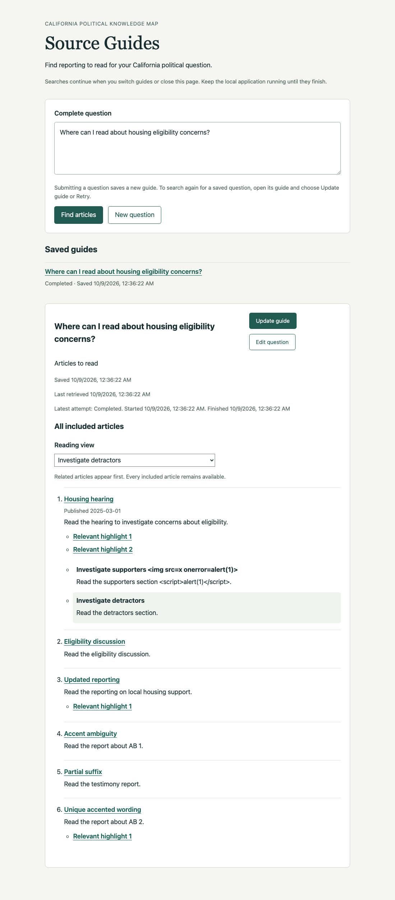
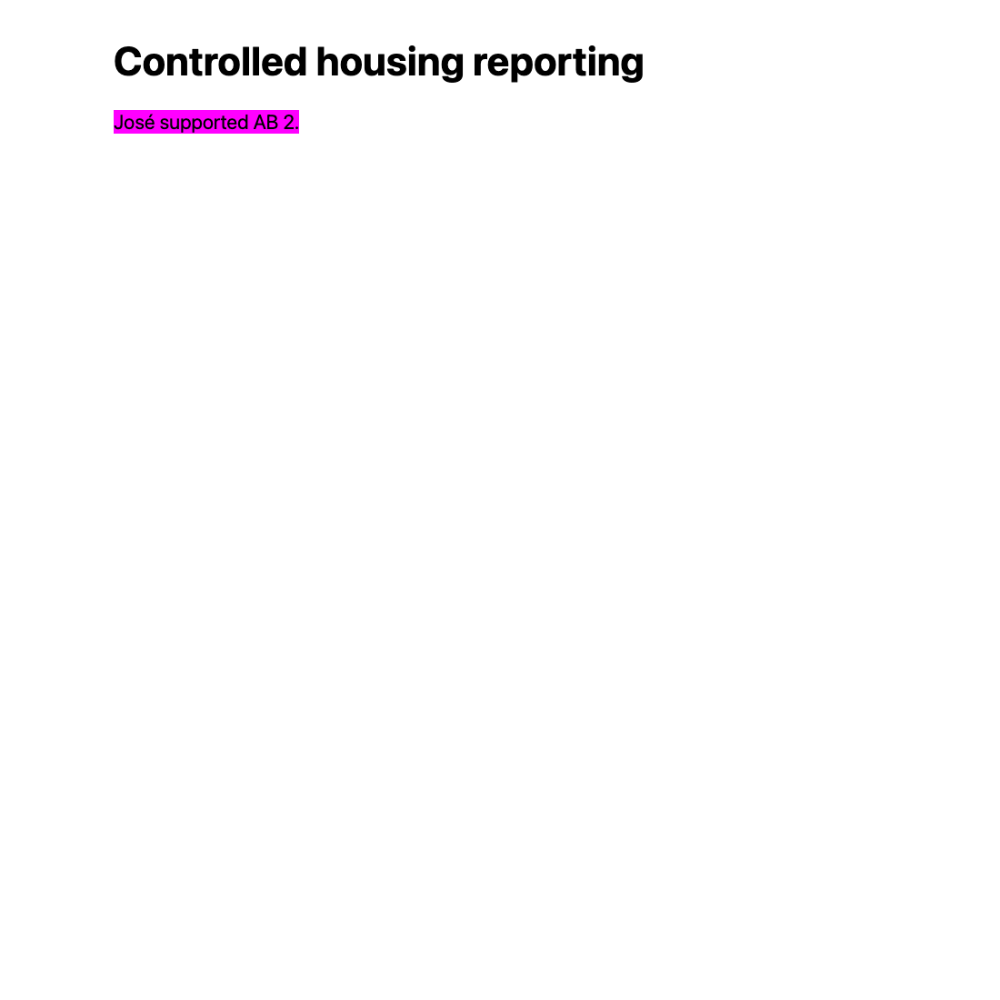

# Ticket 08 independent review

Reviewed on 2026-10-09 UTC against fixed point
`0ab6cfe87628418963b705fe835cb50f58a7f9f2` with
`git diff 0ab6cfe87628418963b705fe835cb50f58a7f9f2...HEAD`.
Implementation commit: `246f02f6e240a8acf28d081061a74dd8c59473c9`.
Separate parallel Standards and Spec reviewers used the repository code-review
skill. Neither reviewer authored the implementation.

The review read AGENTS.md, CONTEXT.md, tracker/domain conventions, relevant ADRs
including 0001, 0003, 0015, 0016, 0017, 0022 and 0023, ticket 08, the parent PRD,
the [implementation evidence](ticket-08.md), and the implementation diff.
The maintainer's clarification governs acceptance: each included article appears
once as a non-highlighted link, with available verified highlights nearby.

## Standards

No documented-standard breaches and no concrete smell findings.

The diff distinguishes original Story content from coreference-modified
Grounding Evidence, preserves shared application/evaluation presentation, and
adds typed navigation URLs without changing prompts, ingestion, or evaluation
persistence. The issue has one triage-state label and evidence under `work/`.

The Standards reviewer rechecked the corrections and found no new breaches.
The standard-library helper preserves original spelling and uses ordinary
fallback for letters whose comparison remains uncertain. The comment explains
the matching problem; the tests exercise the public HTTP boundary.

## Spec

Two P2 findings.

- Accent-equivalent repeats can target the wrong occurrence. Ticket 08 requires
  "sufficient context when needed" and fallback for "Ambiguous repeats". The
  original uniqueness check ignored case only. Through HTTP with temporary
  SQLite, original `Jose opposed AB 1. Elsewhere. José opposed AB 1.` and the
  selected second sentence emitted a context-free accented target. The
  [WICG matching algorithm](https://wicg.github.io/scroll-to-text-fragment/#find-a-range-from-a-node-list)
  ignores accents as well as case, so a conforming browser can match the earlier
  sentence. The emitted URL was reproduced through HTTP; the original browser
  outcome was inferred from the specification.
- Suffix context can end inside a word. Ticket 08 asks for links that highlight
  verified Story wording where supported. A repeated first sentence followed by
  selected `Supporters questioned hous` in original `Supporters questioned
  housing.` emitted that incomplete suffix. The
  [WICG suffix algorithm](https://wicg.github.io/scroll-to-text-fragment/#find-a-range-from-text-directive)
  requires a word boundary at its end. The generated link cannot highlight the
  unchanged page. The target guard did not cover the suffix endpoint.

No other missing requirements or scope creep. Rejecting coreference-changed
passages is an allowed conservative fallback.

## Dispositions and acceptance

Both findings were accepted and fixed. Comparison normalizes compatibility
characters, folds case, and removes combining marks before checking uniqueness.
Letters or digits that remain outside ASCII cause conservative ordinary fallback
rather than an attempt to implement complete Unicode collation. Generated URLs
still use exact original Story wording. Suffix context must end at a word boundary
in the original text before it can be emitted.

Five public HTTP regressions failed before the corrections and passed afterward:
accented/unaccented repeats in both orders, a decomposed-accent repeat, an
unmapped-letter fallback, and a suffix ending inside `housing`. A positive case
proves that unique accented wording retains its original spelling in the URL.
The Spec reviewer reran the section-link suite, 24 passed, and confirmed both
findings resolved without new issues. There are no rejected, duplicate,
out-of-scope, or unresolved findings and no maintainer question.

All seven ticket criteria are checked. Ticket 08 has exactly one triage-state
label, `completed`. The authoritative work README lists tickets 01 through 08
as completed and ticket 09 as takeable. The parent PRD remains `ready-for-agent`.

## Browser correction verification

The review inspected the original reader/context screenshots and all five
correction screenshots. Cached Chromium and the installed Python Playwright
package exercised the real application at `http://127.0.0.1:8939`, with temporary
real SQLite and deterministic external model/retrieval dependencies. Controlled
publisher pages used `http://localhost:8939`. Commands used uv, a 45-second overall
bound and five-second control waits. No browser runtime was installed and no CUA
or native-browser acquisition was retried. The browser and server were closed.

- Submission, three reading views, and reload retain six unique ordinary article
  URLs and four nearby highlights. Group directions and articles without targets
  remain available, and adversarial display values remain literal text.
- Accent-equivalent repeats and partial suffix context have no highlight link.
  Their ordinary links open readable publisher content in separate tabs without
  directives.
- A unique `José supported AB 2.` target opens with its original accented spelling
  and visibly highlights the exact sentence.
- Existing repeated wording highlights the intended second occurrence before
  the supporters context, scrolling to 868px. The second target independently
  highlights the renters sentence at 942px.
- Ordinary links remain non-highlighted. A changed publisher page remains
  readable through both its stale target and ordinary link. All nine popup
  navigations preserve the open guide and use `noopener noreferrer`.

## Final checks

All Python/Node commands use uv and `UV_CACHE_DIR=/tmp/source-guides-uv`.
Cached type tooling also uses `UV_TOOL_DIR=/tmp/source-guides-tools`.

- Focused HTTP, group, web, and shared evaluation checks: 84 passed. One existing
  Pydantic Evals event-loop deprecation warning.
- `uv run --no-sync pytest -q tests`: 1562 passed, 61 skipped, one existing
  OpenRouter reasoning/temperature warning, 50.50 seconds after the final fixes.
  Existing local HTTP tests ran with approved loopback permission. An initial
  restricted run failed only where temporary servers could not bind sockets,
  with nine failures and eight setup errors. The permitted final run passed.
- Node CI editing suite: 29 passed.
- Cached ty over the changed presentation, evaluation, schema and web modules,
  and Ruff over those modules plus affected tests: passed. No SQLite changes
  were required by review. Whole `sqlite_db.py` type/lint cleanliness is not claimed; the original
  implementation evidence records its two preexisting `lastrowid` type
  diagnostics and 79 Ruff diagnostics, matching the fixed-point baseline.
- JavaScript syntax check: passed.
- Tracker consistency and `git diff --check`: passed.

Standards: zero findings. Spec: two P2 findings, both fixed. No valid finding
remains unresolved.
