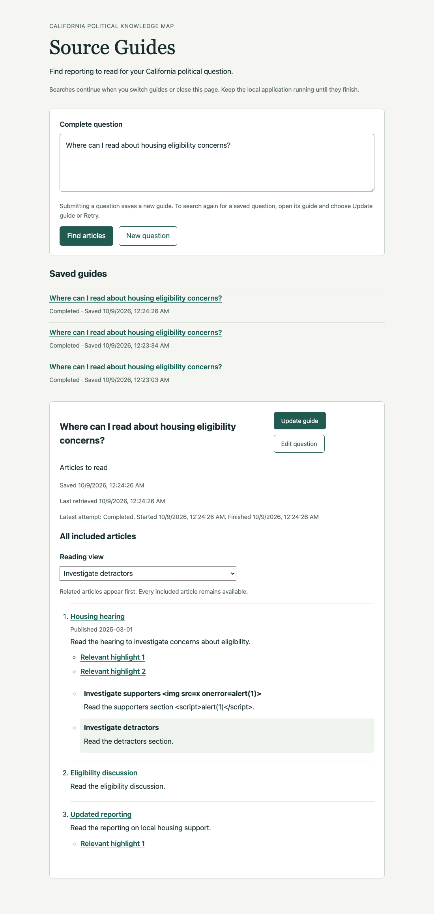
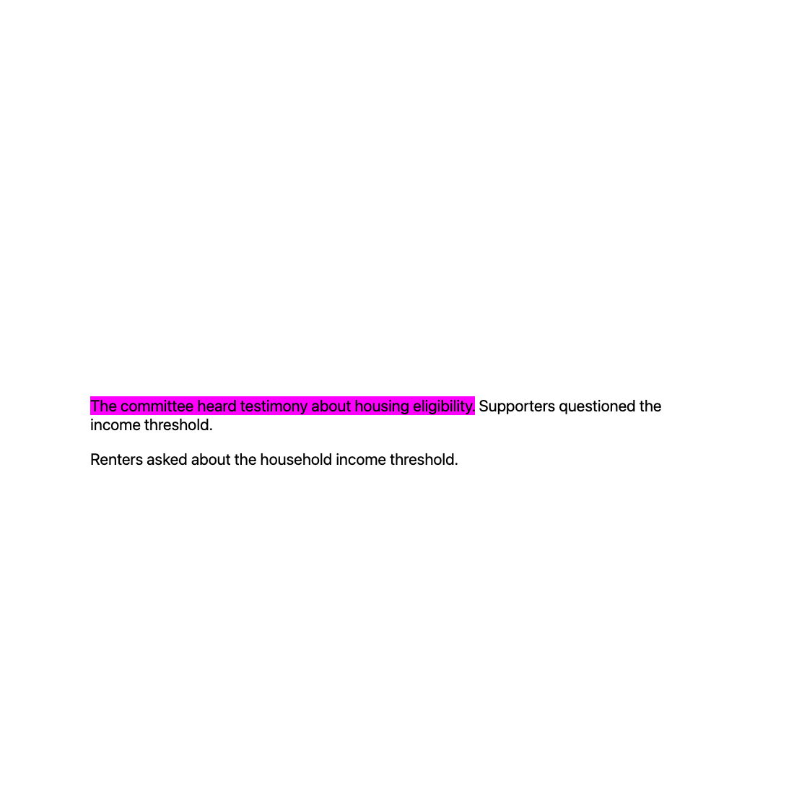
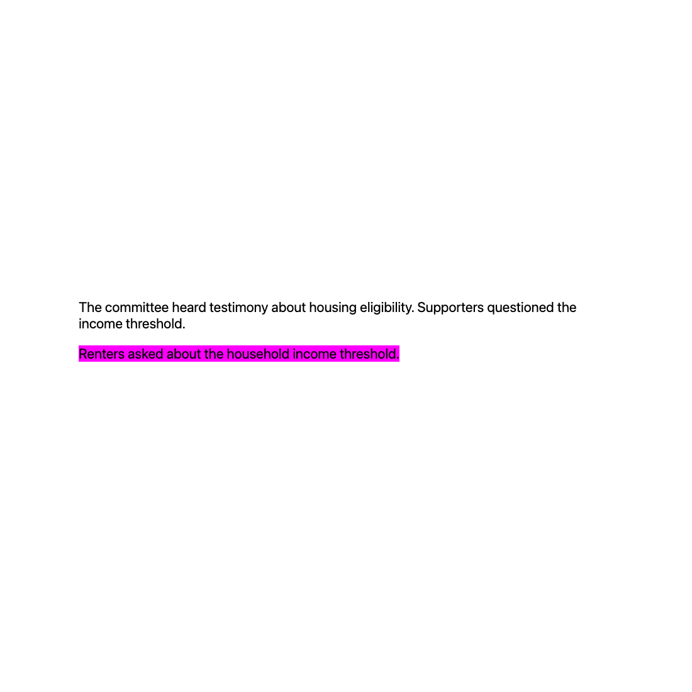
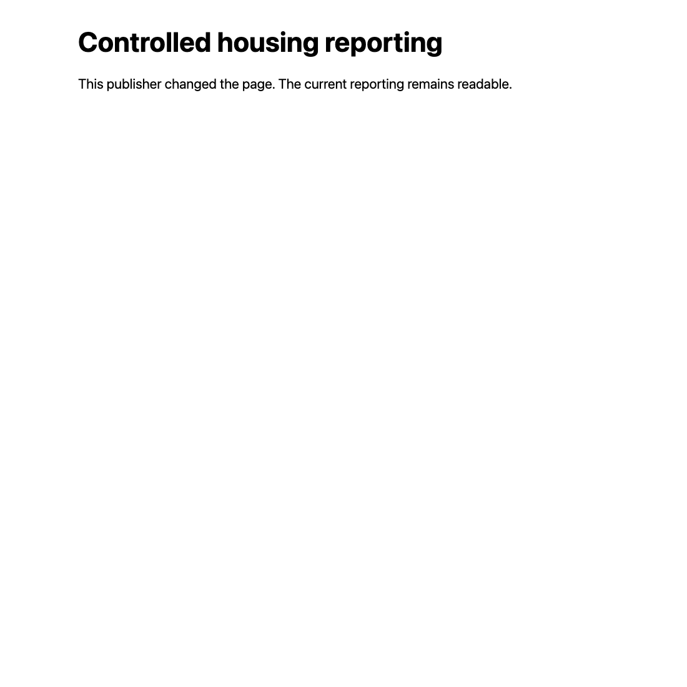

# Ticket 08 implementation evidence

Implemented on 2026-10-09 against fixed point
`0ab6cfe87628418963b705fe835cb50f58a7f9f2`. Acceptance remains with independent
review. Ticket 09 coverage work remains separate.

## Chosen seams

The primary automated seam is the existing FastAPI HTTP/ASGI application with
real temporary SQLite and deterministic model/retrieval dependencies. Original
Story fixtures are saved through the existing SQLite adapter. Assertions observe
submitted and reopened guides, including a new application instance over the same
store. No private methods or independent Chat Session tests are added.

Browser verification uses the actual reader controls and controlled publisher
pages through the already-installed Python Playwright and cached Chromium.
Computer-use acquisition was not retried. Shared evaluation rendering is a
secondary consumer of the same reader-safe projection.

The maintainer's clarification governs presentation: "An article should always
appear once as a non-highlighted link and if we have them, a list of relevant
highlights should appear in close proximity." Group directions and the complete
article list remain available in every reading view.

## Implementation

The existing projection reads original Story content from the SQLite document
store only while preparing the new guide. Lookup uses the included Source
Article identity, which must identify the same HTTP(S) destination as its
citation. The read-only lookup closes its connection and does not create a
missing database. Missing original content or an unavailable Story table leaves
the article available without a section target.

A selected passage must occur unchanged in the original Story after whitespace
normalization. The entire passage must have one location, including when repeated
wording varies by case or whitespace. No coreference reverse substitution or
resolved offset is used. This deliberately rejects a passage whose coreference
replacement changed any of its wording, even if a smaller sentence survived.

The target is the first sentence, bounded to 160 characters at a word boundary.
A repeated compact target needs a unique following context, bounded to 80
characters. If the location or bounded context remains ambiguous, no target is
created. A target starting or ending inside a word is also rejected. Duplicate
targets are consolidated; distinct selected passages can yield multiple links.

Generated links retain the source destination and any existing page anchor,
remove incoming text directives, and encode fragment syntax characters. They
follow the [text-fragment syntax and context rules](https://wicg.github.io/scroll-to-text-fragment/#syntax).
The ordinary URL also removes incoming text directives so its title link remains
non-highlighted. HTTP(S) validation continues to reject unsafe source schemes;
a generated URL too long for the existing URL type falls back without stranding
the search.

`GuideArticle.section_links` stores only typed target URLs. Reopening parses the
saved guide without reading Stories, retrieving chunks, calling a model, or
scraping. Legacy guides default to an empty section-link list. The browser and
shared evaluation renderer keep one ordinary article link, then list numbered
highlight links nearby without quotation previews or chunk metadata. The
existing nearby group directions remain available.

## Acceptance evidence

| Criterion | Evidence |
| --- | --- |
| Original Story targets for included sources | HTTP tests save original Stories through the SQLite adapter. Unchanged wording yields a target; changed coreference wording, absent content, and a mismatched citation destination yield ordinary fallback. The original and cited source identities must agree. |
| Ambiguous or uncertain locations fall back | HTTP tests cover exact repeats, case-only repeats, whitespace-only repeats, blank content, a partial word, a long single word, and an overlong URL. A repeated compact first sentence receives unique suffix context when the full selected passage establishes its location. |
| Save safe targets and ordinary URL | A fresh application instance returns identical saved URLs after the original Story has changed and model/retrieval dependencies are unavailable. Existing DOM anchors are retained and incoming unverified text directives removed. |
| One ordinary link plus nearby highlights | HTTP covers two distinct targets for one article and duplicate-target consolidation. All three browser reading views have three unique ordinary article links, with two highlights at the hearing article and one at the changed-page article. The article without targets remains visible. Two overlapping group directions remain beside the hearing article. |
| Separate tabs and useful fallback | Browser clicks open both real highlights and ordinary links in separate tabs with `noopener noreferrer`. The repeated wording highlights the intended second occurrence. A changed page reached through a stale target remains readable, and its ordinary link also opens successfully. The guide stays open. |
| No chunks or unsafe source references | HTTP tests cover omitted articles, omitted group members, unsafe javascript/data/file URLs, and a distinctive chunk sentinel. Public output has no passage bodies, chunk IDs, or previews. The browser renders adversarial labels and directions as text with no injected image/script nodes. |
| No live alignment promise or ingestion overhaul | The implementation reads existing stored Story wording and writes guide navigation only. No prompt, ingestion stage, scraper, DOM map, or model contract changes. Controlled changed-page navigation demonstrates the limit of stored targets. |

## Red-green development

Recorded failing tests before implementing each behavior: missing section-link
output; repeated compact wording without context; case/whitespace ambiguity;
incoming directives and reserved syntax; cross-article citation targeting;
partial-word and overlong targets; shared evaluation rendering; blank wording.
The initial browser check failed because highlight links were not yet rendered.
After adding the nearby list, real highlighting and fallback navigation passed.

The first test fixture for partial-word and long targets used conflicting
citation metadata for one Source Article. That fixture failed during assembly;
it was corrected to one consistent selected chunk before the product failures
were observed. The long-URL and blank-wording regressions initially left a search
running; both now complete with ordinary links.

## Browser verification

The real application ran on `http://127.0.0.1:8938`, with a temporary SQLite
store and deterministic external dependencies. Controlled publisher pages used
`http://localhost:8938` so clicks exercised cross-origin text-fragment navigation.
The already-cached Chromium run had a 45-second overall bound and five-second
control waits. No browser runtime was installed. The temporary server and
browser were closed afterward.

The final script exited successfully after submission, all three reading views,
six popup navigations, and reload of the saved guide. Each view retained one
ordinary link per source and all three section links. Both actual highlights
were visually inspected in screenshots. The context target scrolled to 868px
and highlighted the second occurrence before the supporters context; the other
target scrolled to 942px and highlighted the renters sentence. Ordinary links
opened without directives. The changed-page target and its ordinary link both
reached readable current content without highlighting.

One intermediate script attempted to click a Search details control that does
not exist in the ticket 08 reader. That harness action was removed before the
successful rerun; it did not cause a product change. Ticket 09 still owns the
expanded coverage/details work. Reload retained all ordinary links, targets,
and group directions. Fresh-process durability is verified by HTTP tests.

## Checks

All Python and Node commands use uv with `UV_CACHE_DIR=/tmp/source-guides-uv`.
Type checking uses `UV_TOOL_DIR=/tmp/source-guides-tools` and the cached tool.

- Focused HTTP sections, groups, web, and shared evaluation checks: **78 passed**,
  one existing Pydantic Evals event-loop deprecation warning.
- `uv run --no-sync pytest -q tests`: **1556 passed, 61 skipped**, one existing
  OpenRouter reasoning/temperature warning, **54.45 seconds** after the final
  implementation changes. Existing loopback tests ran with approved permission.
- `uv run --no-sync node --test tests/chat_eval_review_editing.test.mjs tests/rag_eval_review.test.mjs tests/chunk_eval_review.test.mjs`: **29 passed**.
- `uv tool run --offline --from ty ty check` over the changed presentation,
  evaluation, schema, and web modules: **passed**.
- Including the preexisting `sqlite_db.py` module in that type check reports
  **two existing return-type diagnostics** for `cursor.lastrowid`. A baseline
  copy from the fixed-point tree reports those same two diagnostics; neither is
  in the new Story reader. Whole-module type checking is not claimed to pass.
- Ruff over the other changed Python modules and tests: **passed**. Full
  `sqlite_db.py` lint reports **79 existing diagnostics**, with the same counts
  and categories as the baseline copy. No SQLite lint cleanup is included.
- `uv run --no-sync node --check src/knowledge_map/resources/source-guides/guide.js`: **passed**.
- `git diff --check`: **passed**.
