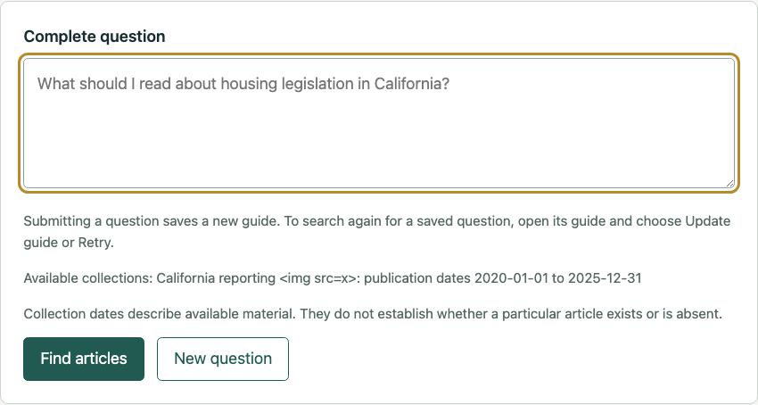
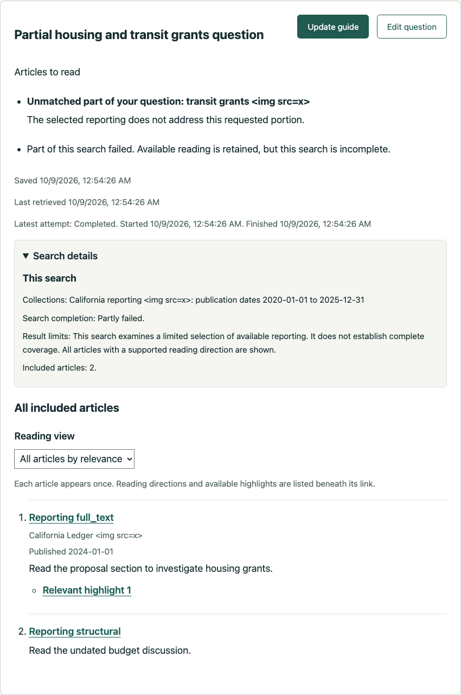
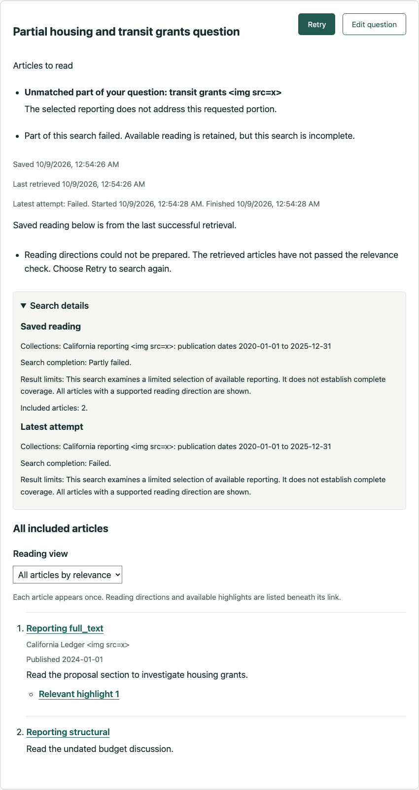
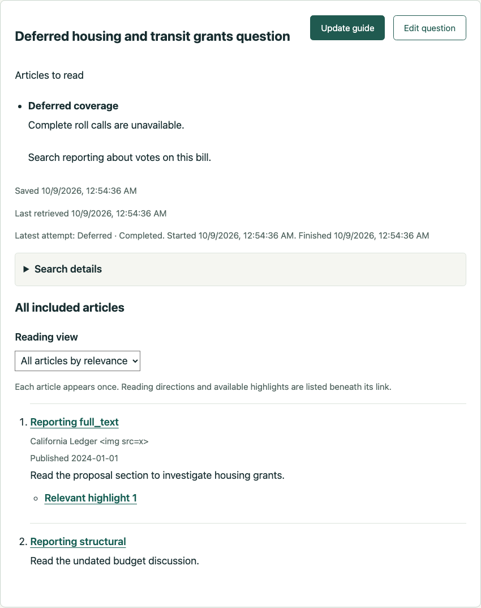

# Ticket 09 implementation evidence

Fixed point: `887110ec4e9d3aeff7aefc473f0037e08dcccafc`.

## Public seams

The ticket conductor authorizes these seams without a separate confirmation:
HTTP/ASGI submission, read, update and coverage endpoints with real temporary
SQLite; the existing shared chat/retrieval evaluation workflow with controlled
model and retrieval dependencies; actual reader controls in cached Chromium.
Assertions observe public responses and saved reads, never private methods or
SQL rows. Publication fixtures use the existing document-store writers.

Assessment still happens before retrieval. The existing Chat Agent supplies
typed unmatched portions after retrieval. This presentation work does not change
Declined/Deferred eligibility, substitute a recoverable task, or add an agent.
The controlled coverage and evidence-support issues remain the owners of future
assessment timing and semantic changes. Their pending labels are not Gold.

## Implementation and acceptance evidence

| Criterion | Evidence |
| --- | --- |
| Available collections and dates near entry, retained with limits | `/api/coverage` returns a reader projection with collection name, date basis and known endpoints. The form explains that collection dates do not prove article presence or absence. Submission and update save this scope before execution. HTTP proves failed assessment and restart retain the original scope when current coverage changes. |
| Source metadata without inference | Publication names come from the exact article URL's recorded `scraped_html_cache.publication_id` and registered Publication. Missing names and publication dates are omitted. HTTP proves a later Publication rename does not change saved content. Browser shows the linked title, supplied Publication, supplied date and reading direction; an undated source has no invented metadata. |
| Typed unmatched portions and partial failure | The existing Chat Agent returns typed `unmatched_requests` during guidance. Included articles remain unchanged by these disclosures. Typed branch outcomes produce a generic partial-search disclosure, preserving useful sibling evidence without exposing retrieval methods. HTTP and shared evaluation prove persistence and safe rendering. |
| Distinct empty, rejected, failed, Declined and Deferred explanations | Deterministic HTTP cases distinguish `no_matches` from `irrelevant_candidates`, retrieval failure, assembly failure and guidance failure. Existing assessment states remain authoritative. A guidance failure also retains an existing Deferred explanation and recoverable portion. Successful empty and rejected results explicitly avoid claiming real-world absence. |
| Saved disclosures and collapsed Search details | Content and latest-attempt disclosures/details persist independently. HTTP changes the current collection during a failed update and proves prior reading, disclosures, limits and retrieval time remain unchanged. Search details show collection dates, completion, bounded selection, whether material was omitted and included-article count. Browser checks initial collapse, expansion and collapse after reload. A failed update shows separate Saved reading and Latest attempt sections. |
| Typed states and safe display | Prose containing words such as declined, deferred and failed does not classify a result. The reader ignores unstructured introductions. Adversarial collection, Publication and unmatched-portion text remains literal text, with no injected image/script elements. HTTP and browser output exclude the chunk sentinel, internal routes/ranks and branch-specific diagnostics. |
| Existing eligibility and evidence-support semantics | Assessment still precedes retrieval and receives the original question. Final guidance adds unmatched reading portions without a new classifier, agent, policy gate or substituted task. The existing controlled evaluation runner and shared chat/retrieval rendering own the checks. This work does not settle the pending coverage/evidence-support workstream's broader assessment decisions. |

Each article still appears once as an ordinary non-highlighted link, with
available verified highlights nearby. The existing section/group suites pass.
The final browser run checks two ordinary links and one nearby highlight before
and after a failed update, without changing the established navigation behavior.

## Red-green record

The first HTTP scope test failed on missing `search_details`. After persistence
was added, it passed across failed assessment and restart. The unmatched/partial
slice initially failed because guidance rejected the new typed output; the new
contract and projection made it pass. The empty/rejected/retrieval/guidance matrix
then failed on missing typed disclosures before its implementation. Publication
initially failed on its absent saved field, then passed through recorded metadata
and restart. The existing shared evaluation test failed because the rendered
output omitted the named unmatched portion, then passed with safe typed rendering.
A further red test caught Deferred explanations being lost on guidance failure.

The browser check initially failed on the missing Search details control. The
first completed harness run also revealed an inadequate wait that could observe
the previous guide's status. The final check waits for the exact submitted
question and its terminal attempt before inspecting each outcome. One temporary
test collection error was an indentation mistake in an updated expectation; it
was corrected before the relevant behavior was checked.

The first full CI run found nine old expectations: technical/prose messages,
the adopted prompt digest, and optional Publication serialized as null instead
of omitted in HTTP. Their expectations now describe the new public behavior.
No independent Chat Session tests were added.

## Controlled semantic assessment

Instruction v11 adds typed unmatched portions to final guidance while preserving
the v10 assessment instructions. Its ten-case local Gemma run completed with no
execution failures. Housing/transit kept housing reading and named the transit
gap; empty retrieval and irrelevant evidence produced different explanations;
a failed branch kept useful sibling reporting.

That run exposed one specific mistake: a request for where to read about grant
eligibility had both a valid article direction and an unmatched disclosure because
the selected passage identified the eligibility section without reproducing its
full details. Instruction v12 corrects this distinction between finding reading
and supplying a standalone answer. It changes only guidance and is explicitly
selected by the production/shared evaluation consumer. v11 and its report remain
available. A focused three-case v12 run corrected that case, retained the actual
transit gap, and retained the successful-empty explanation.

- [v11 ten-case report](../../../../evals/reports/chat/20261009T075114Z-887110e-local-gemma4-26b-c6ea49447276.json)
- [v12 three-case report](../../../../evals/reports/chat/20261009T075241Z-887110e-local-gemma4-26b-c6ea49447276.json)

Commands used `uv run --no-sync python
work/projects/source-guides/validation/run_controlled.py`, first without filters,
then with `--case SG09-partial --case SG09-empty --case SG09-failed-search`.
The deployment was local `gemma4:26b`, with a 120-second request timeout and one
attempt. These fixed fictional training examples are unlabeled, not independent
accuracy measurements or Gold. Model-generated assessment/direction quality
remains uncertain; this ticket does not claim complete coverage or a calibrated
semantic success rate. Historical reports and prompt versions are untouched.

## Browser evidence

Cached Python Playwright/Chromium ran the real application on
`http://127.0.0.1:8940` with real temporary SQLite and deterministic model/retrieval
dependencies. No browser runtime was installed and no CUA/native Chrome acquisition
was retried. The final interaction run was bounded at 55 seconds with five-second
control waits. It exercised Partial, Empty, Irrelevant, Retrieval failure,
Guidance failure, Declined and Deferred submissions, plus reload and the failed
update. The screenshots were visually inspected. The browser was closed after
each run; the disposable server was stopped afterward.

## Checks

Commands use `UV_CACHE_DIR=/tmp/source-guides-uv`; cached type tooling also uses
`UV_TOOL_DIR=/tmp/source-guides-tools`.

- Focused HTTP, source groups, section links and shared evaluation: **118 passed**,
  one existing Pydantic Evals event-loop deprecation warning.
- Affected existing audit, Jev, cancellation and prompt-version checks after
  expectation adoption: **56 passed**.
- Final `uv run --no-sync pytest -q tests`: **1574 passed, 61 skipped**, one
  existing OpenRouter reasoning/temperature warning, **51.83 seconds**. Existing
  tests that bind loopback servers ran with approved permission.
- Node CI editing suite: **29 passed**.
- Cached `uv tool run --offline --from ty ty check` on changed guide, retrieval
  schema, chat, presentation, guide store and web modules: **passed**.
- Ruff on the changed modules/tests apart from baseline `sqlite_db.py`: **passed**.
- JavaScript syntax and `git diff --check`: **passed**.
- `sqlite_db.py` retains **two existing return-type diagnostics** for `lastrowid`
  and **79 existing Ruff diagnostics**, matching the ticket 08 baseline. None is
  in the new Publication reader. Whole-module type/lint cleanliness is not claimed.
